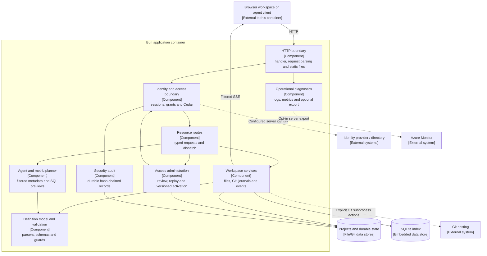

# Architecture

Semantic Workbench is a file-first definition editor with a React browser application and a Bun
HTTP API. Git-backed project folders are authoritative; SQLite is a disposable derived index.
The application parses metadata to explain metrics and produce query previews. It does not
execute those previews, connect to warehouses or perform standards reasoning.

The [README stack](README.md#technology-stack) lists the current libraries and versions.
[User workflows](docs/user-guide.md), [server operation](docs/server-mode.md),
[configuration](docs/configuration.md) and [development](docs/development.md) own their detailed
contracts. This document describes responsibilities, data flow and boundaries rather than
repeating every control, endpoint or release result.

## C4 level 3: backend components

[The README](README.md#c4-level-1-system-context) contains the system-context and runtime-container
views. This view opens the Bun application container. Each box is a responsibility inside one
server process, not a separately deployed service. Data stores and external integrations remain
outside that component boundary. The diagrams use standard Mermaid flowcharts with C4-style
labels; they do not require a C4-specific renderer.

Public probe/brand/authentication responses have explicit boundary rules; the main request path
shown above applies access enforcement before workspace dispatch. Static serving does not turn
protected documents into public assets.

Local mode binds loopback and supplies an implicit Admin. Server mode resolves a person or an
eligible agent identity and enforces a filtered view before a workspace service runs. The same
file/model/governance logic is reused; local mode is an explicit path, not a missing permission
check that happens to succeed.

## Code map

### HTTP, startup and ownership

- `src/` has three runtime areas. `src/app/` is the browser application, `src/server/` the Bun-only
  runtime, and `src/shared/` the code both import. `src/shared/` imports only itself and
  `src/generated/`; the server never imports `src/app/`, and the browser imports nothing from
  `src/server/` but types; `tests/layout-boundaries.test.ts` enforces these directions. Each area groups its files by feature (`app/metrics/`,
  `shared/metrics/`). `src/server/index.ts` composes startup, storage, authentication, brand,
  telemetry and the listener.
  `src/server/config.ts` is the typed runtime configuration boundary. Startup diagnostics live in
  `src/server/startup-log.ts`; signal and hot-reload cleanup live in `src/server/shutdown.ts`.
- `src/server/handler.ts` composes health/static handling and route dispatch.
  `src/server/request.ts` owns bounded body/path parsing. `src/server/serve-options.ts` owns listener
  behavior, and `src/server/routes/http.ts` maps typed failures to HTTP responses.
- `src/server/routes/` parses resource-specific requests and calls owning services. It must not
  implement Git subprocesses, filesystem transactions or independent authorization rules.
- `src/server/static.ts` serves `dist/` with path confinement and security policy.
  `src/server/routes/health.ts` exposes liveness/readiness without workspace inspection.
- `src/server/projects/data-root.ts` probes writable storage. `instance-lock.ts` owns the exclusive
  lease and revision handover. Recovery, migration, scanning and access-service initialization
  follow ownership; a waiting instance must not initialize another writer's workspace.

### Filesystem, Git and personal working copies

- `src/server/projects/workspace.ts` is the workspace composition root. It wires registration,
  reads/saves, scanning, Git, journals, trash, working copies, publishing and event delivery.
- `paths.ts` owns data layouts and path validation; `state.ts` owns the registry and persistent
  state; `reader.ts` defines the caller's filtered view, owner and content guard.
- `atomic.ts` replaces files without modifying untouched bytes. `journal.ts` coordinates
  multi-file/folder/registry changes. `migration.ts` reads legacy databases through protected
  copies and stages the file-store migration.
- `scanner.ts`, `cache.ts` and `watcher.ts` maintain derived models/findings and detect disk
  changes. Cache rows are not another authoritative copy of the definitions.
- `git.ts` is the subprocess boundary for Git; `scm.ts` owns Source Control behavior and converts
  project-relative paths to repository paths. Commands are serialized per underlying repository,
  including all of its worktrees.
- `repositories.ts` and `repository-projects.ts` interpret the multi-project manifest.
  `sparse-folder.ts` owns partial/sparse checkout steps; `project-folder.ts` coordinates a reviewed
  local move into a repository folder.
- `working-copies.ts` selects published versus personal read/write locations. `worktrees.ts`
  owns Git worktree/branch transitions. `publishing.ts`, `published-checkout.ts` and
  `unpublished-work.ts` coordinate default-branch publication, recovery and retained local work.
- `trash.ts`, `personal-state.ts` and `suggestions.ts` own deletion/restore, owner-specific state
  moves and explicit-evidence grouping suggestions.
- `project-export.ts` selects permitted files/history and checks limits before streaming;
  `zip.ts` writes the archive. Export logic must not bypass a Reader's permissions.

### Identity, authorization, governance and administration

- `src/server/auth/authentication.ts` composes provider identity, sessions, directory membership and
  the single administration repository. It does not depend on provider-specific protocol details.
- `sign-in-provider.ts` selects a provider interface implementation: `msal-provider.ts` for
  Entra, `oidc.ts` for Keycloak/generic. `managed-identity.ts`, `id-token.ts` and
  `sign-in-error.ts` share token/assertion validation and safe failures.
- `sessions.ts` and `attempts.ts` own encrypted/revocable sessions, provider indexes and replay
  protection. `principal.ts` normalizes trusted claims; `directory.ts` performs bounded directory
  lookups; `bearer.ts` accepts the restricted agent-token path.
- `grants.ts`, `role-compiler.ts`, `cedar.ts` and `authorize.ts` resolve scoped role membership,
  build policy entities, compile/load Cedar policies and make access decisions.
  `policies/` holds the baseline, built-in roles and replay matrix.
- `route-actions.ts`, `middleware.ts` and `request-scope.ts` map requests to actions/resources,
  resolve identity once and attach the filtered scope. Unmapped protected routes fail closed.
- `write-access.ts`, `git-access.ts` and `project-creation.ts` authorize concrete write targets,
  repository-wide actions and new-project domains before mutation.
- `src/shared/governance/guards.ts` contains shared pure content rules and classification levels. Server
  `auth/guards.ts` binds them to a principal. Browser `src/app/auth/guards-client.ts` explains the
  controls but cannot authorize a write.
- `admin-repo.ts`, `access-admin.ts`, `dry-run.ts`, `admin-guard.ts`, `policies.ts` and
  `change-summary.ts` own versioned access documents, reviewed proposals, replay, last-Admin
  protection and activation. Requested rollback is a new reviewed commit.
- `remote-hosts.ts`, `remote-credentials.ts` and `github-oauth.ts` choose permitted remote hosts
  and command-scoped credentials. `src/server/bin/sw-askpass` is the final host-specific credential
  boundary; Git filters and local merge steps must not inherit remote tokens.

### Parsing, editing, metrics and agent planning

- `src/shared/core/model.ts` projects supported definitions into entities and relationships.
  `src/shared/validation/` owns input checks, diagnostics and RDF parsing; it validates Ossie files
  against the one shipped schema version (`OSSIE_SCHEMA_VERSION`); any other version gets the structural
  checks and a "not validated" notice instead of the schema check. `shacl.ts` runs a shapes file, SPARQL constraints included, against a data file with
  the `shacl-engine` library, loaded on demand in the browser; `src/app/validation/ShaclCheck.tsx`
  lets the user pick the data file. `src/shared/odcs/foreign-keys.ts`
  resolves contract relationships. These modules are reused by browser and server logic.
- `src/shared/mappings/` owns mapping schemas and built-ins; `src/app/mappings/` the mapping
  explorer: `MappingExplorer.tsx` picks the mappings that are, or read, the open file
  (`mapping-scope.ts`), `MappingSection.tsx` shows one mapping, and `mapping-view.ts` turns the
  context the agent API returns into the rows and cards. `src/shared/core/` holds the model and document references; `src/app/core/export.ts`
  the export projection.
- `schemas/` contains pinned standards and application schemas. `scripts/compile-schemas.ts`
  produces checked-in, formatted standalone browser validators grouped by schema family in
  `src/generated/validators.js`;
  browser CSP does not need runtime evaluation to compile schemas.
- `src/app/editor/` owns CodeMirror configuration, serialization/embedded-language highlighting,
  and findings. Byte-range patches are `src/shared/editor/patch.ts`, which the server also uses.
  `documentMode.ts`, `viewportYaml.ts`, `largeYaml.ts` and
  `yamlIndentation.ts` keep large-document work within its highlighting budget.
- `src/shared/edit/` builds item models, source text and serialization-aware YAML/JSON patches.
  `src/app/edit/` holds the item editors, source fragments, insertion/deletion and the RDF patches,
  which additionally verify the intended graph difference.
- `src/shared/metrics/` resolves dependencies, bindings, extensions and metric saves;
  `src/app/metrics/` draws the metric views and wizards. `src/shared/sql/` lints SQL and finds its
  regions; `src/app/sql/` highlights it in the browser. None of them access a data source.
- `src/server/agent/explain.ts`, `runtime.ts` and `sql.ts` produce filtered catalog/context,
  definition-preserving metric explanations and governed query plans. They never execute a plan or
  call an LLM. Synthetic example execution belongs only to verification scripts/tests.

### Browser shell and graph rendering

- `src/app/main.tsx` composes the application. `src/app/workspace/` is the workbench shell. Its about 18
  state hooks sit in `hooks/`, apart from `Workspace*` presentation and dialogs; smaller features
  keep their `use*` files next to their components. Stable event handlers call the latest committed logic;
  source text stays synchronous rather than being deferred back into the editor.
- `WorkspaceHeader` decides what the header shows; `HeaderTitle` draws the file name and the meta
  line, `SaveStateButton` the save state (inline text, or a dot on a phone) and `HeaderActions`
  Commit and the More actions menu. One `moreActionItems` list defines New and Export for every
  width.
- One action history serves Back and Forward. `src/app/workspace/action-history.ts` is the pure list of steps
  and cursor; `action-recorder.ts` groups the state changes of one click into one step and
  remembers the values of screens that unmount; `ActionHistoryContext.tsx` owns the recorder,
  mirrors each step into `history.pushState` and moves the cursor on `popstate`.
  `useRecordedState` replaces `useState` for state a click changes, and keeps state in the
  component that owns it. Typing is not recorded; undo and redo never record.
- The selected project is the context of the whole app. `useWorkbench` holds one recorded choice,
  `resolveSelectedProject` in `src/shared/core/selected-project.ts` turns it into a project that exists,
  and every view derives from it: showing a document selects its project, fallbacks open the first
  file of that project, and Mappings, metrics, Source Control, Trash and
  Import read it instead of keeping their own project choice. `src/shared/core/project-scope.ts`
  (`documentsOfProject`, `firstDocumentOfProject`) scopes documents for the browser and for server
  agent requests, so references never resolve across projects.
- `src/app/projects/api.ts` is the browser HTTP boundary. `useEvents.ts` owns SSE delivery and
  connection readiness. `autosave.ts` coordinates validation, drafts, version checks and saving.
  `Sidebar.tsx` keeps the selected file reachable in the scrolling project list.
- `src/app/scm/` owns Source Control, diffs, branch/commit/remote/clone dialogs and personal-credential
  prompts. Its `*.ts` files hold the pure wording rules for Git state: push rejection, tracking,
  clone summary and sign-in command. `src/app/workspace/EmptyProject.tsx` is the canvas for a project with
  no definitions. `src/app/projects/Modal.tsx`, `Menu.tsx`, `WizardStepper.tsx`, `EmptyState.tsx` and
  `src/app/components/ScrollStrip.tsx` provide shared interaction and layout behavior;
  `src/app/projects/useAnchoredPopup.ts` places and dismisses the popups that menus and the Settings
  panel draw beside their button. `Menu.tsx` opens a submenu beside its menu when the window has
  room and in place under **Back** otherwise; `menu-position.ts` holds the pure placement rules.
- `src/app/components/` contains UI used by several features; `src/app/theme/` owns runtime
  palettes and browser preference. The root of `src/` holds only the three runtime areas,
  `src/generated/` and browser type declarations.
- `src/app/auth/` consumes server-reported identity and capabilities. `src/app/admin/` is the browser
  administration feature, reached from the sidebar's Settings panel through `admin-entry.ts`: it proposes/reviews access changes through its typed client and is
  separate from the server's versioned `DATA_DIR/admin/` configuration repository. Admin URL hashes
  select sections; no general routing framework computes authorization in the browser.
- `src/app/graph/` owns whole-model and neighborhood views, traversal, grouping projection, layout,
  workers, controls, name wrapping and shared edge appearance. `overview.ts` and `communities.ts`
  decide display grouping, not standard semantics. The Network layout runs on the main thread
  (`network-layout.ts`; there is no network-layout worker), while ELK layered layout and routing stay
  in workers. `text-fit.ts` sizes names, cards and tiles to show whole names and holds the shared
  camel-case-to-words wording; `area-links.ts` summarises how areas link to each other for the tile text.
- `src/app/odcs/lineage.ts` builds declared column dependencies; `LineageCanvas.tsx`, `LineageCard.tsx`
  and `LineageColumnList.tsx` draw row ports, selection and windowed column lists. Mapping canvases
  reuse this infrastructure with resolver-derived cards/lines.
- `docs/graph-design.md` describes ELK layered versus area tiles, worker routing, card measurement,
  viewport fitting and the pinned React Flow observer patch. No WebGL/Sigma renderer is active.

### Branding, observability and delivery

- `src/shared/theme/theme.css` defines semantic light/dark tokens; `src/app/theme/theme-palette.ts` is the
  runtime group palette. `src/app/theme/theme-preference.ts`, `src/app/workspace/ThemeControl.tsx` and `public/theme-init.js` own browser
  choice.
- `public/brand/` is the default bundle. `src/server/brand/` loads and sanitizes it once at startup;
  `src/app/brand/` consumes the known public assets; `src/shared/brand/manifest.ts` lists them. Product identity must not be duplicated in view
  components. `docs/theme.md` owns deployment/customization details.
- `src/server/observability/` owns typed settings, redaction, request context, explicit spans/metrics,
  logs, browser report recording and optional exporter loading. SDK/exporter imports stay behind
  `telemetry.ts`; ordinary application code uses the no-op-capable OpenTelemetry API.
- `src/app/observability/` owns bounded browser reporting to the workbench API; the report shape
  both sides check is `src/shared/observability/browser-report.ts`. No browser exporter
  contacts an external ingestion host. `src/server/auth/audit.ts` remains a separate durable security
  record, with integrity verification described in `docs/audit-tamper-evidence.md`.
- `Dockerfile`, `compose.yaml`, `scripts/image.ts` and `container-*.ts` own image construction and
  local validation. `scripts/ci-validate.ts` orchestrates the canonical gate/suite inventories.
- `scripts/deploy.ts` owns delivery decisions behind real/fake Azure clients. Pipeline lint and
  dry-run interpret the shipped YAML offline. `deploy/` owns target setup, release hand-over and
  real acceptance; those operations do not happen during application startup.

## Request and state flow

### Opening and editing a definition

1. The browser obtains identity/capabilities, project registration and readable document bytes.
2. Parsing creates a view model; worker validation produces located findings during editing.
3. An item or Source edit becomes an exact text/byte-range change against a known base hash.
4. Middleware resolves the Reader, route action and concrete write targets. Services authorize
   every target and apply content guards before staging any mutation.
5. A valid save is hash-checked, atomically replaced and reindexed. A multi-file change uses the
   journal. Invalid text remains a personal draft rather than replacing the definition.
6. Filtered live events trigger readable clients to refresh. A stale save remains refused until
   the person explicitly resolves the version conflict.

### Shared-server writes and publication

1. Reads use the published checkout unless the caller may edit and already has a personal copy.
2. The first authorized write is judged against published content before creating that copy.
3. Edits and commits remain in the caller's branch; other readers are not silently moved to it.
4. Publication checks exact commits and compare-and-swaps the default branch. Recovery finishes
   an interrupted checkout update. Publication is separate from remote Push.
5. All worktrees of a repository share its serialized Git queue. Sparse paths, multi-project
   ownership and protected content apply to both direct changes and incoming Git content.

### Access administration

1. A typed proposal is validated and replayed against configured cases, recent audit and known
   identities, without changing live policy.
2. The dry-run receipt is bound to proposal content and base version. An edit or stale version
   requires a new review; client checks supplement the same server requirement.
3. Confirmation makes an Admin-authored versioned commit, reloads access and closes affected
   sessions/streams as required. Failed validation/last-Admin checks do not mutate live state.
4. Policy reload failures are logged with the committed version; existing policy remains active
   until a subsequent reload rather than pretending the commit never happened.

## Invariants and dependency limits

- **Definition ownership:** project files and durable state are authoritative. Rebuildable indexes
  never become another source of truth. Stop the app before removing a cache or taking a backup.
- **Byte preservation:** untouched content, serialization and line endings remain unchanged.
  Saves carry a base version; conflicts are not automatically overwritten.
- **One owner:** exactly one active writer owns a data root. Lease handover and journals support
  interrupted operations, not arbitrary multi-replica writes. Shared-host lease expiry needs
  synchronized clocks.
- **Path confinement:** operations stay inside permitted data/repository roots, reject ambiguous
  case variants and do not follow project symlinks. Git identity changes are never global.
- **Filtered derived data:** model search, metric/agent resolution, history, export, suggestions,
  SSE delivery and replay use the same Reader boundaries. Hidden references stay unresolved.
- **Guarded writes:** direct saves, import, move, restore, revert and incoming Git content all
  pass target authorization and content guards. Non-typed access bypasses must not be invented.
- **Personal state:** server drafts, view corrections, worktrees and unpublished work remain
  owner-scoped. Removal events snapshot current readers before the project disappears.
- **Credentials:** provider/remote tokens remain server-side and encrypted; a remote credential
  is available only to its permitted host and command. Public brand/probe responses carry no
  workspace data.
- **No analytic execution:** production code only explains and plans. Example verification may
  run isolated synthetic SQL, never a user's warehouse or workspace database as an analytic source.
- **Controlled rendering:** node measurements may be reused only with compatible identity/type/
  dimensions or row/port topology. Observer-driven layout publication runs outside delivery and
  pending work is cancelled on unmount. Browser tests record raw resize events, not only JS throws.
- **Optional export:** local mode and missing telemetry configuration never load an exporter
  pipeline or open an ingestion connection. Operational logs, audit and telemetry have distinct
  retention/redaction and failure contracts.

## Where to change a behavior

| Behavior | Starting point |
| --- | --- |
| Runtime setting | `src/server/config.ts`, then `docs/configuration.md` |
| Route/resource | `src/server/routes/` and `auth/route-actions.ts` |
| Access decision | `auth/authorize.ts`, Cedar policies and grant/compiler modules |
| Content protection | `src/shared/governance/`, then server/client bindings |
| Definition syntax | `src/shared/core/model.ts`, `src/shared/validation/`, `src/shared/odcs/` and pinned schemas |
| Byte-preserving item edit | `src/shared/edit/`, `src/app/edit/` and `src/shared/editor/patch.ts` |
| Metrics/bindings/plans | `src/shared/metrics/`, `src/app/metrics/`, `src/server/agent/` |
| Graph layout/routing | `FullGraph.tsx`, `src/app/graph/`, `src/app/odcs/` |
| Git/repository behavior | `src/server/projects/git.ts`, `scm.ts`, working-copy modules |
| Theme/brand | Tokens and `public/brand/`; server sanitation under `src/server/brand/` |
| Diagnostics/export | `src/server/observability/`, browser report schema and recorder |
| Quality gate | `scripts/gate-suites.ts`, container suites and `ci-validate.ts` |

Use [the development guide](docs/development.md) for command syntax, fixture rules and validation.
Keep configuration/API/operation details in their canonical guides instead of appending release
history or per-control instructions to this architecture map.
