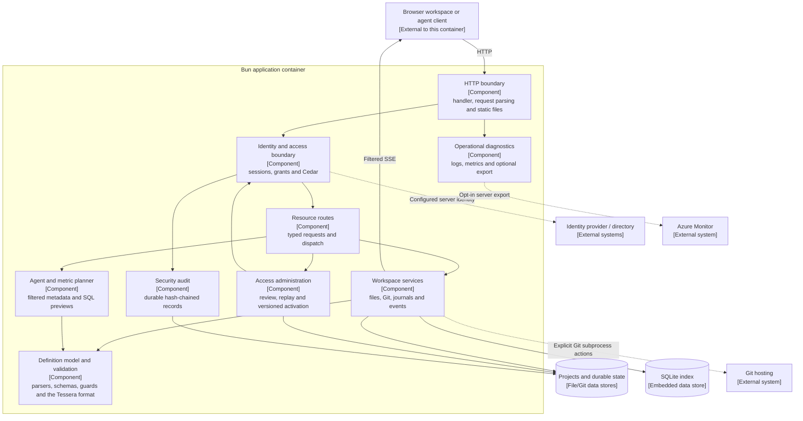

# Architecture

Semantic Workbench is a file-first definition editor with a React browser application and a Bun
HTTP API. Git-backed project folders are authoritative; SQLite is a disposable derived index.
The application parses metadata to explain metrics and produce query previews. It does not
execute those previews, connect to warehouses or perform standards reasoning.

The [README stack](README.md#technology-stack) lists the current libraries and versions.
[User workflows](docs/user-guide.md), [server operation](docs/server-mode.md),
[configuration](docs/configuration.md) and [development](docs/development.md) own their detailed
contracts. This document describes responsibilities, data flow and boundaries rather than
repeating every control, endpoint or release result.

## C4 level 3: backend components

[The README](README.md#c4-level-1-system-context) contains the system-context and runtime-container
views. This view opens the Bun application container. Each box is a responsibility inside one
server process, not a separately deployed service. Data stores and external integrations remain
outside that component boundary. The diagrams use standard Mermaid flowcharts with C4-style
labels; they do not require a C4-specific renderer.

Public probe/brand/authentication responses have explicit boundary rules; the main request path
shown above applies access enforcement before workspace dispatch. Static serving does not turn
protected documents into public assets.

Local mode binds loopback and supplies an implicit Admin. Server mode resolves a person or an
eligible agent identity and enforces a filtered view before a workspace service runs. The same
file/model/governance logic is reused; local mode is an explicit path, not a missing permission
check that happens to succeed.

The integration view shows what the application reads and contacts, and what it never does.

## Code map

- `src/server/projects/item-diff-sides.ts` takes comparison definitions and provenance from the same
  published commit, saved working copy, visible branch tip or readable commit, using the snapshot size limits.
  `src/server/auth/item-diff-access.ts` applies the project, file and branch visibility rules.
  `src/server/projects/item-diff.ts` compares structured items with destination-only migrations and reports files it could not compare.
- `src/shared/item-diff/` owns comparison side parsing, parsed model item extraction, field comparison and
  address-based pairing independently of files, Git and browser state. Child item collections do not
  cascade changes to their containers; relationship roles remain a named relationship field.

- `src/shared/attributes/` owns the attribute rule, inheritance and display order over Ossie relationships.
- `src/app/attributes/` renders and edits attribute rows and shows where value types are used.
- `src/app/agent-context/` edits item context and labels the preview as working copy content.
- `src/app/governance/` presents ontology and metric governance using the shared governance model.

- `src/shared/core/address-kinds.ts` owns the versioned item-address kind registry and parent rules.
- `src/shared/core/item-address.ts` owns canonical parsing, document locators, formatting, relative resolution and whole-segment prefix operations.
- `src/shared/core/address-migration.ts` validates rename ownership, matches deletion prefixes and applies ordered records without I/O.
- `src/shared/core/model-addresses.ts` derives and resolves structured definition items, detects duplicates and flags positional ancestors as volatile.
- `src/shared/core/model.ts` derives required locators for structured entities and links in narrower inspector results; RDF and built-ins stay unaddressable.
- `src/shared/mappings/relationship-reference.ts` owns inherited relationship matching shared by the agent and rename reference analysis.
- `src/app/edit/relationship-references.ts` walks mapping targets without guessing their defining concept.
- `src/shared/edit/address-changes.ts` derives explicit item/scope declarations from workbench edits.
- `src/app/projects/save-reply.ts` validates acknowledgements before client base versions advance.
- `src/shared/core/item-key-adapters.ts` resolves older labels against derived locators and refuses ambiguous or unresolved qualified names.
- `src/app/odcs/lineage-addresses.ts` indexes structured card and row locators for lineage; dotted labels are presentation text and ambiguous labels are never guessed as references.
- `src/app/graph/center-preference.ts` verifies the previous browser center preference before writing a stable locator.
- `src/app/graph/selection-addresses.ts` translates structured graph selections and walk centers at the renderer boundary.
- `src/app/workspace/hooks/useGraphAddresses.ts` records canonical state while retaining renderer IDs and existing grouping/persistence boundaries.

Repeated metric reference reads share a model-local index within one validation/query; no index survives edits.
The pure address modules do not read application state. Consumers build text through `formatAddress`, never by
concatenating project, document or item names.

### HTTP, startup and ownership

- `src/` has three runtime areas. `src/app/` is the browser application, `src/server/` the Bun-only
  runtime, and `src/shared/` the code both import. `src/shared/` imports only itself and
  `src/generated/`; the server never imports `src/app/`, and the browser imports nothing from
  `src/server/` but types; `tests/layout-boundaries.test.ts` enforces these directions. Each area groups its files by feature (`app/metrics/`,
  `shared/metrics/`). `src/server/index.ts` composes startup, storage, authentication, brand,
  telemetry and the listener.
  `src/server/config.ts` is the typed runtime configuration boundary. Startup diagnostics live in
  `src/server/startup-log.ts`; signal and hot-reload cleanup live in `src/server/shutdown.ts`.
- `src/server/handler.ts` composes health/static handling and route dispatch.
  `src/server/request.ts` owns bounded body/path parsing. `src/server/serve-options.ts` owns listener
  behavior, and `src/server/routes/http.ts` maps typed failures to HTTP responses.
- `src/server/routes/` parses resource-specific requests and calls owning services. It must not
  implement Git subprocesses, filesystem transactions or independent authorization rules.
- `src/server/routes/agent.ts` owns catalog, context and plan handlers, with one document-source
  callback shared by all three operations. Production uses the pinned snapshot; browser-only
  preview routes use the editing source and retain the same resolver and planner.
- The route inventory declares `readSource` for definition content, context, plans and explanations.
  It is an inventory, not router enforcement: owning handlers select the source. Agent rows
  use published data, metrics use the request surface and export uses its source query.
- `src/server/static.ts` serves `dist/` with path confinement and security policy.
  `src/server/routes/health.ts` exposes liveness/readiness without workspace inspection.
- `src/server/projects/data-root.ts` probes writable storage. `instance-lock.ts` owns the exclusive
  lease and revision handover. Recovery, migration, scanning and access-service initialization
  follow ownership; a waiting instance must not initialize another writer's workspace.

### Filesystem, Git and personal working copies

- `src/server/projects/workspace.ts` is the workspace composition root. It supplies the shared local-commit lookup and wires registration,
  reads/saves, scanning, Git, journals, trash, working copies, publishing and event delivery.
  The use cases it composes live in `src/server/projects/workspace/`: `import-batch.ts` (imports,
  new projects from a batch, examples, project folder creation), `document-save.ts` (saves and
  reverts), `file-move.ts` (moves between folders and projects) and `git-identity.ts`
  (repository Git identity and credential helper). Each receives a small context object.
- `paths.ts` owns data layouts and path validation; `state.ts` owns the registry and persistent
  state; `reader.ts` defines the caller's filtered view, owner and content guard.
- `atomic.ts` replaces files without modifying untouched bytes. `journal.ts` coordinates
  multi-file/folder/registry changes. `migration.ts` reads legacy databases through protected
  copies and stages the file-store migration.
- `address-key-stores.ts` locates active and archived grouping stores.
- `address-key-conversion.ts` backs them up, verifies original hashes, and journals their one-time conversion.
- `address-migrations.ts` validates request declarations for routes and stages bounded, ordered history in the project’s Git working copy within the owning journal.
  Document-save services receive typed declarations and check their effect against the guarded source.
- `address-resolution.ts` resolves current items and visible history behind the reader boundary.
- `address-reconciliation.ts` receives an already-authorized reader and records explicit reconciliation through the project lock and journal.
- `routes/item-addresses.ts` validates scoped locator requests and dispatches these services only after the shared
  operation boundary admits their inventoried HTTP or in-process twin; the route authorizes the target file before passing its reader.
- Shared `grouping-addresses.ts` translates stable assignment keys while keeping renderer IDs at the UI boundary.
- `scanner.ts`, `cache.ts` and `watcher.ts` maintain derived models/findings and detect disk
  changes. Cache rows are not another authoritative copy of the definitions.
- `published-initialization.ts` adopts the existing default-branch tip on first open without
  touching the checkout or index. Only server startup repairs the detached published checkout,
  after validating that existing changes can be preserved. Defaults resolve from the remembered name, remote HEAD, then an existing configured initial branch,
  main or master. Unknown defaults remain usable without a snapshot and ask the person to choose one.
- `published-snapshot.ts` resolves pinned commits independently of editing readers, filters no
  permissions until `readableDocuments` applies the supplied reader, checks historical provenance and retains current, previous and actively pinned indexes.
  Pins also capture registry layouts, so folder changes apply to subsequent requests. The workspace
  memoizes the registry by its file version; each pin captures that registry, independent of later writes.
- `project-export.ts` plans both editing and published ZIPs; published entries capture pinned bytes
  before streaming, so eviction or publication cannot change an archive in flight.
- `snapshot-index.ts` reads committed project files with the shared byte validator. Concurrent
  builds share one promise per repository, commit and folder digest; limits reject whole builds.
  Publication validation holds an active candidate pin through settlement, then releases it on success
  or refusal. The first published read reuses that index within the existing retention bound.
  A request that needs set validation first projects the candidate tree to the caller's readable
  definitions, before opening restricted blobs or building the shared index.
- `publication.ts` is the single publication writer and repository queue for local Publish, server Publish,
  remote follow and adoption. It applies `publication-checks.ts`, writes intent, compare-and-swaps the ref,
  records the pointer and supersedes the resolver. A failed swap abandons intent. `recover` finishes or drops
  interrupted intents at startup, before the server checkout is repaired, and `adoptInitial` records the first
  pointer of a repository that already has default-branch history; both are registered upgrade steps. Server adoption and base repair live in `worktrees.ts`.
- `scm-published.ts` formats publication identity and authoring distance for Source Control; its
  acknowledgement writes only the caller's typed personal publication notice. Legacy synthetic file entries
  migrate into that notice once at startup (`migrateLegacyPublicationNotices`), so status reads never write. Status checks compare ref identity and cache
  ancestry/counts by ref and pointer; Git events invalidate and refresh that cache. The wire shape lives in shared SCM types.
- `local-publication.ts` preserves the local index and working files when authoring moves to
  `work/local`, and advances the default ref through the shared checks and durable pointer protocol.
  Its Publish and Adopt callers use the shared publication queue without replacing local authoring files.
  Publishing coordinates rescans and events.
- `published-pointer.ts` owns atomic publication records and interrupted-publication transitions.
  `state.ts` persists these records in `state/published.json`, separately from the derived cache.
- `git.ts` is the subprocess boundary for Git. Immutable object reads use queued `ls-tree` and
  `cat-file --batch` calls, preflight blob sizes and disable lazy fetching; `scm.ts` owns Source Control behavior and converts
  project-relative paths to repository paths. Commands are serialized per underlying repository,
  including all of its worktrees. `scm-context.ts` holds what its parts share (dependencies,
  blockers, repository paths, refresh after a change); `scm-remote.ts` runs fetch, pull, push,
  sync and remote settings; `scm-branches.ts` lists, switches and creates branches.
- `repositories.ts` and `repository-projects.ts` interpret the multi-project manifest.
  `sparse-folder.ts` owns partial/sparse checkout steps; `project-folder.ts` coordinates a reviewed
  local move into a repository folder.
- `working-copies.ts` selects published versus personal read/write locations. `worktrees.ts`
  owns Git worktree/branch transitions. `publishing.ts`, `published-checkout.ts` and
  `unpublished-work.ts` coordinate default-branch publication, recovery and retained local work.
- `trash.ts` owns deletion and the delete preview; `trash-restore.ts` restores entries and
  `trash-access.ts` holds the pure rules about what a guard sees and who may see or restore an
  entry. `personal-state.ts` and `suggestions.ts` own owner-specific state moves and
  explicit-evidence grouping suggestions.
- `project-export.ts` selects permitted files/history and checks limits before streaming;
  `zip.ts` writes the archive. Export logic must not bypass a Reader's permissions.

- Shared proposals: `shared/proposals/` holds the pure model (names, identifiers, derived status, contribution
  branch names and scope judging). `proposal-store.ts` writes `state/proposals/<repo>.json` atomically and
  `proposal-refs.ts` owns the Git refs. A failed ref transaction checks the expected refs again.
  A mismatch is stale state, while a storage failure returns a generic operation error.
  `proposals.ts` creates, lists and views; `proposal-contribution.ts`,
  `proposal-promotion.ts` (also startup recovery) and `proposal-closing.ts` do the rest, all inside the
  repository publication queue. Startup reconciles a close or restore when the Git transaction moved
  the ref but the proposal record still holds the earlier state. An interrupted close records
  recovery as the closer because the actor is unavailable. Promotion reuses `moveDefault` through `worktrees.promote`.
  `work-in-progress-push.ts` refuses pushing work and proposal branches. `routes/proposals.ts` exposes the
  routes and `auth/proposal-access.ts` decides authority. The browser side is `app/proposals/`.
  The proposal visibility boundary allows a reader of any declared project to see the name, creator,
  contributors and tip. Unreadable project names are filtered. These shared metadata fields can
  disclose information across declared projects if the author includes it in the proposal name.

### Identity, authorization, governance and administration

- `src/server/connections/` owns program registrations, consent grants, token rotation and session-bound connections.
  Server MCP authenticates through `mcp/server-mode-gate.ts` and supplies a fresh caller to the existing
  operation boundary for every request. Scopes narrow effects; the connection end signal cancels its work.
  Receipt replay uses the same inventoried route and authorization checks, with the original
  restore target retained when the trash entry is consumed. The stdio bridge keeps rotating
  client tokens in a private, atomic per-server cache.
  Tokens on the server persist only as keyed hashes; the original browser cookie is never recovered.
  Delegated Git credential updates use the session store reference under its existing mutation lock,
  preserving the browser session idle clock and refusing updates after session end.

- `src/server/auth/request-surface.ts` records the authenticated caller’s browser or consumer surface through
  `request-scope.ts` at the operation boundary, using a symbol on the request and one setter.
  The HTTP adapter supplies validated browser metadata; MCP callers always consume published definitions.
  Local browser markers are a guardrail.
- `src/server/auth/authentication.ts` composes provider identity, sessions, directory membership and
  the single administration repository and mirrored audit log with configured retention. The same
  log reaches the handler and administration service. Standalone handlers construct one through
  `defaultAudit` when none is supplied. Authentication does not depend on provider-specific protocol details.
- `sign-in-provider.ts` selects a provider interface implementation: `msal-provider.ts` for
  Entra, `oidc.ts` for Keycloak/generic. `managed-identity.ts`, `id-token.ts` and
  `sign-in-error.ts` share token/assertion validation and safe failures.
- `sessions.ts` and `attempts.ts` own encrypted/revocable sessions, provider indexes and replay
  protection. `principal.ts` normalizes trusted claims; `directory.ts` performs bounded directory
  lookups; `bearer.ts` accepts the restricted agent-token path.
- `grants.ts`, `role-compiler.ts`, `cedar.ts` and `authorize.ts` resolve scoped role membership,
  build policy entities, compile/load Cedar policies and make access decisions.
  `policies/` holds the baseline, built-in roles and replay matrix.
- `request-authentication.ts` owns network rate limits, local Host/Origin checks, bearer validation, cross-site checks and principal resolution.
  `refusal.ts` shares durable denial responses with the operation boundary. The boundary accepts only
  mode, access, audit and remote-credential dependencies and does not depend on the HTTP adapter.
- `twin-request.ts` builds credential-free requests from inventory ids, encoded parameters, sorted queries and the existing body limits.
- `operation-execution.ts` carries the admitted operation’s reviewed internal steps across asynchronous work.
  Pointer advance and abandoned intent are steps of Publish, adoption or authorized remote follow, with
  the enclosing operation’s decision and single audit outcome. Snapshot reads are reviewed read steps.
  The registered publication upgrade includes intent recovery and first-pointer adoption (the
  `publication.recover` and `publication.adopt-initial` steps) at trusted workspace initialization or
  repository registration. Clone and registration owners declare
  its local-write and publication connection effects;
  it has no transport dispatch. Direct domain calls remain available to embedded code and isolated tests.
- `operation-inventory.ts` validates `policies/operation-inventory.json` with the application Ajv schema and resolves operation ids and route rows.
- `operation-boundary.ts` owns route decisions, effective-permission listing, target refusal mapping,
  handler execution and audit for authenticated callers. `createHandler` exposes that same instance
  as `handler.boundary` to trusted in-process adapters; invocation requires a minted caller.
  Identity attachment clears prior publication outcomes so reusing a request cannot carry stale audit metadata.
  `route-verdict.ts` owns the pure admission decision shared by invocation and listing, including
  client actions, no-access refusals, Steward audit passes and resolved trash targets. Listing
  reuses action and target-kind probes within one call. `authorize.ts` supplies representative
  projects with identical metadata and effective role membership; arbitrary administrator rules and
  clients retain exact project probing. No listing decision cache survives the call.
- `src/shared/observability/operation.ts` owns the origin and outcome vocabulary shared by audit,
  authorization and instrumentation; operation label validation stays in the boundary.
- `caller.ts` mints authenticated caller context with runtime provenance. `middleware.ts` is the HTTP
  adapter; `route-actions.ts` maps method/path rows to actions and resources. `request-scope.ts`
  attaches identity, delegated session and the filtered scope together. Unmapped protected routes fail closed.
- `connection-scope.ts` narrows inventory effects and dynamic Git effects without granting policy access.
- `operation-outcome.ts` classifies bounded response copies after existence hiding.
  `operation-classifiers.ts` registers pure classifiers owned by SCM, clone and save modules.
- `replay-sample.ts` fills independent ordinary and non-HTTP read strata in one backward audit scan.
- `write-access.ts`, `git-access.ts` and `project-creation.ts` authorize concrete write targets,
  repository-wide actions and new-project domains before mutation. Git authorizers also enforce
  dynamic remote and publish connection effects, including fetch follow-up eligibility.
- `src/shared/governance/guards.ts` contains shared pure content rules and classification levels. Server
  `auth/guards.ts` binds them to a principal. Browser `src/app/auth/guards-client.ts` explains the
  controls but cannot authorize a write.
- `admin-repo.ts`, `access-admin.ts`, `dry-run.ts`, `admin-guard.ts`, `policies.ts` and
  `change-summary.ts` own versioned access documents, reviewed proposals, replay, last-Admin
  protection and activation. Requested rollback is a new reviewed commit. The Admin path reuses active
  policy preparation only when roles and administrator policy text match. Proposal boundaries own
  their entities and grants. Replay scopes share unchanged principal policy inputs within one
  comparison; arbitrary administrator rules retain independent evaluation.
  Cedar builds policy-derived action applicability indexes lazily on the first replay, by role,
  principal kind and resource kind. Replay scopes use these indexes and reuse readability decisions; ordinary HTTP scopes
  retain their per-action keys. Both use the same decision function. Reloads replace policy
  indexes and clear scope decisions. Cedar remains the decision authority.
- `remote-hosts.ts`, `remote-credentials.ts` and `github-oauth.ts` choose permitted remote hosts
  and command-scoped credentials. `src/server/bin/sw-askpass` is the final host-specific credential
  boundary; Git filters and local merge steps must not inherit remote tokens.

### Agent endpoint

- `src/server/routes/mcp.ts` serves `POST /api/mcp` in local mode only and does transport work only: it applies the request gate, reads the body under its caps and hands the message to the protocol library. It is mounted by `src/server/handler.ts` when `src/server/index.ts` opened a capability.
- `src/server/mcp/` holds one module per concern: `request-gate.ts` (method, `Origin`, `Host`, capability, content type, in that order), `local-capability.ts` (the secret file), `body-limits.ts`, `server-factory.ts` (builds the protocol server for one request from the registry), `tool-registry.ts` and `tool-definition.ts` (the 23 tools as plain data), `tools/` (grouped by what they do), `twin-dispatch.ts` (runs a tool's request through the operation boundary and maps the answer), `tool-results.ts`, `tool-paging.ts` and `cursors.ts`, `call-limits.ts`, `receipts.ts` (durable retry safety for delete, restore and commit) and `call-audit.ts`.
- Nothing under `src/server/mcp/` reads project files or decides access. A tool is the twin of the inventory operation it names, so adding a tool means adding it to the registry, to the route inventory contract and to `docs/mcp.md`; `tests/mcp/` compares the three.
- `scripts/mcp-stdio.ts` is the bridge for clients that start a program; `scripts/mcp-rotate.ts` rotates the secret.

### Parsing, editing, metrics and agent planning

- `src/shared/core/model.ts` projects supported definitions into entities and relationships.
  `src/shared/validation/` owns input checks, diagnostics and RDF parsing; it validates Ossie files
  against the one shipped schema version (`OSSIE_SCHEMA_VERSION`). A file with another or no version
  still gets the syntax, family, reference and cycle checks, so the write gate keeps refusing broken
  files; only the pinned-schema step is skipped, and an info notice (`NOT_VALIDATED`) says so.
  `shacl.ts` runs a shapes file, SPARQL constraints included, against a data file with
  the `shacl-engine` library, loaded on demand; `src/app/validation/ShaclCheck.tsx` lets the user
  pick the data file and runs it in a worker (`shacl-run.ts`) that is stopped after 30 s. `src/shared/odcs/foreign-keys.ts`
  resolves contract relationships. These modules are reused by browser and server logic.
- `src/shared/mappings/` owns mapping schemas and built-ins; `src/app/mappings/` the mapping
  explorer, which reads the agent catalog, context and plan only through the `api.agent*` methods in
  `src/app/projects/api.ts`. `src/shared/core/` holds the model and document references; `src/app/core/export.ts`
  the export projection.
- `schemas/` contains pinned standards and application schemas. `scripts/compile-schemas.ts`
  produces checked-in, formatted standalone browser validators grouped by schema family in
  `src/generated/validators.js`;
  browser CSP does not need runtime evaluation to compile schemas.
- `src/app/editor/` owns CodeMirror configuration, serialization/embedded-language highlighting,
  and findings. Byte-range patches are `src/shared/editor/patch.ts`, which the server also uses.
  `documentMode.ts`, `viewportYaml.ts`, `largeYaml.ts` and
  `yamlIndentation.ts` keep large-document work within its highlighting budget.
- `src/shared/edit/` builds item models, source text and serialization-aware YAML/JSON patches.
  `src/app/edit/` holds the item editors, source fragments, insertion/deletion and the RDF patches,
  which additionally verify the intended graph difference.
- `src/shared/metrics/` resolves dependencies, bindings, extensions and metric saves;
  `src/app/metrics/` draws the metric views and wizards. `src/shared/sql/` lints SQL and finds its
  regions; `src/app/sql/` highlights it in the browser. None of them access a data source.
- `src/server/agent/explain.ts`, `context.ts`, `runtime.ts` and `sql.ts` produce filtered catalog/context,
  definition-preserving metric explanations and governed query plans. `context.ts` is the entry for resolving a mapping into
  fields, metrics, bindings and findings (`context-types.ts`, `context-documents.ts`, `context-assembly.ts`,
  `context-selection.ts`); `query-plan.ts` builds the SQL preview;
  `runtime.ts` re-exports both as the public entry point. They never execute a plan or
  call an LLM. Synthetic example execution belongs only to verification scripts/tests.

### Usage counters

Usage stages migrations against both sides of a publication and selects them by the published commit.
Usage reads resolve addresses against the pinned model and the reader's file grants.

- `src/server/usage/` owns counts of requests through the workbench, off unless `SW_USAGE_COUNTERS=on`.
  `usage-settings.ts` reads the two variables, `src/shared/usage/usage-counted-operations.ts` parses
  `src/shared/usage/counted-operations.json`, and `usage-items.ts` is the pure rule that finds the
  addresses a counted answer names. `usage-recorder.ts` counts in memory (a no-op object when off) and
  flushes every 30 seconds through `usage-flush.ts` to day files that only `usage-store.ts` touches;
  `usage-migration.ts`, `usage-retention.ts` and `usage-compaction.ts` move counts with item addresses and
  expire them, `usage-read.ts` builds the answer of `usage.read` for one reader, `usage-trash.ts` moves
  counts with a trashed project and `usage-workspace.ts` is the one module that knows the workspace.
  `usage-publication.ts` reads the address history committed in the published commit, the same
  history `src/server/projects/address-migrations.ts` gives published address resolution.
- The operation boundary calls the recorder once after a counted answer exists. It never waits for the
  disk, changes an answer or reads the audit log; no usage module imports audit or telemetry code, and a
  test scans the imports. `state/usage/` is a durable store that is registered in the persisted-key
  inventory and holds counts only.
- `src/app/usage/` is the Traffic display: `traffic-store.ts` asks the server only when the option is on,
  `use-usage.ts` connects it to React, and the badge, mark, legend, toggle and sort components render
  from it. With the option off they render nothing.

### The Tessera format and compiler

`src/server/tessera/unit-source.ts` owns the complete-unit seam; `workspace-unit-source.ts` binds
it to pinned published bytes and the caller's saved working files. `compile-service.ts` reuses the
shared compiler and acceptance/paging decisions. `bundle-files.ts` assembles identical CLI and HTTP
bundle entries, while shared `compile-findings.ts` formats their findings. `workspace-conversion.ts`
connects `convert-service.ts` to Git cleanliness and the existing guarded, hash-checked save pipeline.
`src/server/routes/compile.ts` parses typed requests behind the operation boundary and inventory;
`src/app/compile/` owns review, explicit acceptance, downloads and conversion states. The browser's
one-file preview reuses the shared compiler; the server recomputes the complete unit before saving.
The [compile guide](docs/compile.md) owns HTTP answers, usage and limits. MCP adapters await integration.

The shared `src/shared/tessera/digest.ts` implements synchronous SHA-256 for both runtimes.
The compiler and browser conversion preview use that same function without a bundler alias or
Node imports. Native Bun hashes and browser Web Crypto verify its output at block boundaries.

Tessera is an authoring format that compiles to standard Ossie. Its definitions are pure code in
`src/shared/tessera/`; Git and the file system are touched only in `src/server/tessera/` and the
command line.

- `src/shared/tessera/format.ts` holds the one definition of the name, the marker key, the property
  prefix, the supported revisions and the compiler version. No other module under `src` spells them.
- `src/shared/tessera/registry.ts` is the one list of additions, built from the modules under
  `src/shared/tessera/additions/` and `reserved-names.ts`. Validation,
  the derived schema, the compiler and the loss report all read it. Its header says how to add one.
- `src/shared/tessera/bases.ts` is the table of supported Ossie bases and the check that a base
  leaves the Tessera names alone. Its pinned schema data is copied into `src/generated/` by
  `scripts/compile-schemas.ts`, keeping schema-file imports outside the shared layer.
  `schema-derivation.ts` derives the Tessera ontology schema from a pinned schema and the registry; `scripts/derive-tessera-schema.ts` writes it to
  `schemas/tessera-ontology-1-ossie-0.2.0.dev0.json` and the revision 2 counterpart. `scripts/compile-schemas.ts` compiles both.
- `src/shared/tessera/unit-structure.ts` resolves the root’s declared parts and reports structural
  findings from parsed project files. It never follows links or reads the filesystem.
  `unit-model.ts` combines the concepts in include order and maps item addresses to source files.
  `export-closure.ts` checks the public concept list and computes its canonical interface hash.
  `imports.ts` checks aliases and allow-lists against the resolved public interfaces.
  `dependency-manifest.ts` reads the versioned dependency lock and compares it with the declared imports.
  `qualify.ts` spells compiled concept names from their stable owner and rewrites their references.
  `set-validation.ts` keeps complete-set findings separate from each reader’s visible single-file findings.
  The shared validator selects the revision 3 root or part schema before checking a single file.
  References outside that file are checked at the unit boundary.
  Agent context composes roots with their declared parts from the caller’s pinned published files.
  `src/server/mesh/provider-resolution.ts` reads public interfaces from pinned publication objects
  after checking whether the caller can read the provider project.
  The shared inspector connects allowed aliases to read-only concept nodes that retain the provider’s
  project, ontology, and published version.
  `src/server/routes/mesh.ts` serves provider discovery, dependency status and explicit dependency updates through the operation boundary.
  `src/server/mesh/dependents-registry.ts` rebuilds the provider's dependents index from published lock files.
  `src/server/mesh/mesh-graph.ts` projects the published graph to the reader's visible projects.
  Dependency previews report interface changes. Cross-project links in this revision are workbench-local imports, and compatibility
  verdicts, externally composed ontologies, organization-wide targets and release automation are outside the mesh boundary.
  The shared publication guard checks locks against the immutable candidate tree and pinned provider history before advancing the ref.
  The compile unit source passes root and declared part files, lock metadata and pinned public interfaces to the compiler.
  Mesh bundles merge parts into their roots, qualify imported concepts, and record their provenance and address map in manifest version 2.
  The inspector can build a composed graph with a source-file index. The scanner indexes the
  dependency manifest as project metadata and keeps parse findings per file.
  The workspace graph, catalog and grouping compose the active ontology from the reader’s files.
  A selected concept keeps the address of its original file. Form edits patch that file at its source path.
  When adding a concept, the form offers the root and its declared parts as destinations.
  The journaled batch save checks duplicate concept declarations and records cross-file concept moves.
- `src/shared/tessera/marker.ts` reads the marker (top level only). `validate.ts` gives the Tessera
  findings and picks the derived schema by marker and base. `src/shared/validation/validation.ts`
  calls it at the top of `validateStructured`, and `src/shared/core/model.ts` returns the document
  `format` from `inspect`. That is the whole read path: the editor, the file scan, the save
  endpoints and agent context reach a Tessera document through those two functions, so no route
  or operation was added. `agent-view.ts` projects item context and governance flags for agent context
  and strips the remaining Tessera fields. Production agent handlers read the pinned publication.
- `src/shared/governance/ontology-guards.ts` compares ontology items on the shared write paths.
  The server guard binds approval to `approveOntologyItem` and classification to `editGuarded`.
- `compile-document.ts` removes the marker and additions of one ontology by their disposition;
  `serialize.ts` prints the result; `meaning-check.ts` checks the output keeps the data, the items
  and addresses, the name index and the attribute relationships. `loss-report.ts` builds the report
  and counts lost governance entries by status, parses loss policies
  and decides acceptance; `manifest.ts` builds the manifest; `canonical-json.ts` and `digest.ts`
  give equal input equal bytes. `document-kind.ts` sorts the files of a project folder and
  `compile-unit.ts` compiles the whole folder.
- `src/server/tessera/snapshot-source.ts` reads a committed project folder through the Git helper
  (`src/server/projects/git.ts`), `disk-source.ts` reads a folder for `check`, and
  `bundle-writer.ts` writes the bundle to a temporary folder and renames it.
  `scripts/tessera.ts` is the command line; `scripts/tessera-arguments.ts` and
  `scripts/tessera-output.ts` read its options and print its results.
- Tests live in `tests/tessera/`. The mutation gate adds `scripts/tessera-mutants.ts` and
  `scripts/tessera-mutation-cases.ts`, and the browser check is `scripts/tessera-browser-check.ts`.

Compile flow: read the project folder at a full commit on the default branch (with a data root, the
commit must equal the published one); classify each file as Tessera ontology, standard Ossie or
other; validate every Ossie document with the shared validator; compile the Tessera ones and copy
the others; validate every output with the pinned schema and no notice; run the meaning check;
build the loss report; release only when there is no failure and the loss is accepted exactly; write
the bundle outside the source trees.

### Browser shell and graph rendering

- `src/app/main.tsx` composes the application. `src/app/workspace/` is the workbench shell. Its about 18
  state hooks sit in `hooks/`, apart from `Workspace*` presentation and dialogs; smaller features
  keep their `use*` files next to their components. Stable event handlers call the latest committed logic;
  source text stays synchronous rather than being deferred back into the editor.
- `WorkspaceHeader` decides what the header shows; `HeaderTitle` draws the file name and the meta
  line, `SaveStateButton` the save state (inline text, or a dot on a phone) and `HeaderActions`
  Commit and the More actions menu. One `moreActionItems` list defines New and Export for every
  width.
- One action history serves Back and Forward. `src/app/workspace/action-history.ts` is the pure list of steps
  and cursor; `action-recorder.ts` groups the state changes of one click into one step and
  remembers the values of screens that unmount; `ActionHistoryContext.tsx` owns the recorder,
  mirrors each step into `history.pushState` and moves the cursor on `popstate`.
  `useRecordedState` replaces `useState` for state a click changes, and keeps state in the
  component that owns it. Typing is not recorded; undo and redo never record.
- The selected project is the context of the whole app. `useWorkbench` holds one recorded choice,
  `resolveSelectedProject` in `src/shared/core/selected-project.ts` turns it into a project that exists,
  and every view derives from it: showing a document selects its project, fallbacks open the first
  file of that project, and Mappings, metrics, Source Control, Trash and
  Import read it instead of keeping their own project choice. `src/shared/core/project-scope.ts`
  (`documentsOfProject`, `firstDocumentOfProject`) scopes documents for the browser and for server
  agent requests, so references never resolve across projects.
- `src/app/projects/api.ts` is the browser HTTP boundary. `useEvents.ts` owns SSE delivery and
  connection readiness. `autosave.ts` coordinates validation, drafts, version checks and saving.
  `Sidebar.tsx` keeps the selected file reachable in the scrolling project list.
- `src/app/scm/` owns Source Control, diffs, branch/commit/remote/clone dialogs and personal-credential
  prompts. Its `*.ts` files hold the pure wording rules for Git state: push rejection, tracking,
  clone summary and sign-in command. `SourceControl.tsx` composes `ChangeGroup.tsx` (changed-file rows),
  `DiffPane.tsx` (diff and version compare), `SyncCounters.tsx`, `IgnoreChooser.tsx` and `useRemoteActions.ts`
  (pull, push, publish and remote-action feedback). `src/app/workspace/EmptyProject.tsx` is the canvas for a project with
  no definitions. `src/app/projects/Modal.tsx`, `Menu.tsx`, `WizardStepper.tsx`, `EmptyState.tsx` and
  `src/app/components/ScrollStrip.tsx` provide shared interaction and layout behavior;
  `src/app/projects/useAnchoredPopup.ts` places and dismisses the popups that menus and the Settings
  panel draw beside their button. `Menu.tsx` opens a submenu beside its menu when the window has
  room and in place under **Back** otherwise; `menu-position.ts` holds the pure placement rules.
- `src/app/components/` contains UI used by several features; `src/app/theme/` owns runtime
  palettes and browser preference. The root of `src/` holds only the three runtime areas,
  `src/generated/` and browser type declarations.
- `src/app/auth/` consumes server-reported identity and capabilities. `src/app/admin/` is the browser
  administration feature, reached from the sidebar's Settings panel through `admin-entry.ts`: it proposes/reviews access changes through its typed client and is
  separate from the server's versioned `DATA_DIR/admin/` configuration repository. Admin URL hashes
  select sections; no general routing framework computes authorization in the browser.
- `src/app/graph/` owns whole-model and neighborhood views, traversal, grouping projection, layout,
  workers, controls, name wrapping and shared edge appearance. `NeighborhoodGraph.tsx` composes
  `useNeighborhoodView.ts` (filtering, walk canvas, shown entities and edges), `useNeighborhoodNodes.ts`
  (positions, chunked reveal, separation by measured size) and `NeighborhoodToolbar.tsx`. `FullGraph.tsx` composes `useFullGraphLayout.ts` (layout cache, the Network worker
  and ELK layout) and `FullGraphNodes.tsx` (entity, area and relationship renderers). `overview.ts` and `communities.ts`
  decide display grouping, not standard semantics. The toolbars' drop-down menus, the Group menu
  (`GroupingControls.tsx`) and the Show menu (`ShowMenu.tsx`), share placement, dismissal and keyboard
  focus through `toolbar-menu.ts`.
- `src/app/odcs/lineage.ts` builds declared column dependencies; `LineageCanvas.tsx`, `LineageCard.tsx`
  and `LineageColumnList.tsx` draw row ports, selection and windowed column lists. Mapping canvases
  reuse this infrastructure with resolver-derived cards/lines. `LineageCanvas.tsx` composes
  `useLineageWalk.ts` (recorded walk, centre, hops), `useLineageReach.ts` (which cards show),
  `useLineageLayout.ts` (ELK worker, card measurements), `useLineagePierce.ts` (full pierce worker),
  `useLineageViewport.ts` (first view, Fit, card anchoring), `LineageEdge.tsx` and `LineageToolbar.tsx`.
- `docs/graph-design.md` describes the Network (fCoSE) and Layered (ELK) layouts, worker routing, card measurement,
  viewport fitting and the pinned React Flow observer patch. No WebGL/Sigma renderer is active.

### Branding, observability and delivery

- `src/shared/theme/theme.css` defines semantic light/dark tokens; `src/app/theme/theme-palette.ts` is the
  runtime group palette. `src/app/theme/theme-preference.ts`, `src/app/workspace/ThemeControl.tsx` and `public/theme-init.js` own browser
  choice.
- `public/brand/` is the default bundle. `src/server/brand/` loads and sanitizes it once at startup;
  `src/app/brand/` consumes the known public assets; `src/shared/brand/manifest.ts` lists them. Product identity must not be duplicated in view
  components. `docs/theme.md` owns deployment/customization details.
- `src/server/observability/` owns typed settings, redaction, request context, explicit spans/metrics,
  logs, browser report recording and optional exporter loading. SDK/exporter imports stay behind
  `telemetry.ts`; ordinary application code uses the no-op-capable OpenTelemetry API.
- `src/app/observability/` owns bounded browser reporting to the workbench API; the report shape
  both sides check is `src/shared/observability/browser-report.ts`. `ui-profiling.tsx` adds React
  render timing and interaction latency, active only in a `bun run build --mode profile` build
  (see [development](docs/development.md#profiling-the-react-ui)). No browser exporter
  contacts an external ingestion host. `src/server/auth/audit.ts` remains a separate durable security
  record, with integrity verification described in `docs/audit-tamper-evidence.md`.
- `Dockerfile`, `compose.yaml`, `scripts/image.ts` and `container-*.ts` own image construction and
  local validation. `scripts/ci-validate.ts` orchestrates the canonical gate/suite inventories.
- `scripts/deploy.ts` owns delivery decisions behind real/fake Azure clients. Pipeline lint and
  dry-run interpret the shipped YAML offline. `deploy/` owns target setup, release hand-over and
  real acceptance; those operations do not happen during application startup.

## Request and state flow

### Opening and editing a definition

1. The browser obtains identity/capabilities, project registration and readable document bytes.
2. Parsing creates a view model; worker validation produces located findings during editing.
3. An item or Source edit becomes an exact text/byte-range change against a known base hash.
4. Middleware resolves the Reader, route action and concrete write targets. Services authorize
   every target and apply content guards before staging any mutation.
5. A valid save is hash-checked, atomically replaced and reindexed. A multi-file change uses the
   journal. Invalid text remains a personal draft rather than replacing the definition.
6. Filtered live events trigger readable clients to refresh. A stale save remains refused until
   the person explicitly resolves the version conflict.

### Shared-server writes and publication

1. Agent reads pin immutable published Git objects. Browser previews use the caller’s editing
   view: a personal copy when it exists, otherwise the base checkout. Metrics choose by surface.
2. The first authorized write is judged against published content before creating that copy.
3. Edits and commits remain in the caller's branch; other readers are not silently moved to it.
4. Publication checks ancestry, the complete bounded tree and content guards before recording
   intent, compare-and-swapping the default ref and settling the durable pointer. A request’s pin
   remains unchanged. Outside moves await checked adoption; recovery retains the settled snapshot.
   Local publication preserves authoring files; server publication refreshes the detached base.
   Publication is separate from remote Push.
5. All worktrees of a repository share its serialized Git queue. Sparse paths, multi-project
   ownership and protected content apply to both direct changes and incoming Git content.

### Agent operation

1. The route gates the request, streams its body under the cap of the named tool and gives it to the protocol library, which checks the headers, the envelope and the revision.
2. The tool checks its arguments against its JSON Schema, takes a place under the call limits and builds the request of its twin route.
3. `operation-boundary.ts` decides and audits the call as the twin with the `mcp` origin, and the route runs unchanged. The tool maps the HTTP answer to a result.
4. Delete, restore and commit write a receipt before and after the effect, so a retry returns the original result. A commit also checks the branch, head and file versions in the same turn of the repository queue that commits.

### Proposal contribution and promotion

1. Create registers a proposal ref at the published commit; Work on it gives the caller `work/<handle>.<id>`.
2. Contribute checks the tip is not stale, the branch descends from it, the declared-project scope,
   per-path `edit` and the content guards, then moves the ref by compare-and-swap.
3. Promote dry-runs publication, then fast-forwards the default branch through the shared publication
   path. A tip inside published history reads as promoted.

Startup persists recovered promotion outcomes and their expected tips before removing any
open refs. Later startups retry a promoted proposal's cleanup only when its open ref still
matches that tip.

### Access administration

1. A typed proposal is validated and replayed against configured cases, recent audit and known
   identities, without changing live policy.
2. The dry-run receipt is bound to proposal content and base version. An edit or stale version
   requires a new review; client checks supplement the same server requirement.
3. Confirmation makes an Admin-authored versioned commit, reloads access and closes affected
   sessions/streams as required. Failed validation/last-Admin checks do not mutate live state.
4. Policy reload failures are logged with the committed version; existing policy remains active
   until a subsequent reload rather than pretending the commit never happened.

## Invariants and dependency limits

- **Definition ownership:** project files and durable state are authoritative. Rebuildable indexes
  never become another source of truth. Stop the app before removing a cache or taking a backup.
- **Byte preservation:** untouched content, serialization and line endings remain unchanged.
  Saves carry a base version; conflicts are not automatically overwritten.
- **One owner:** exactly one active writer owns a data root. Lease handover and journals support
  interrupted operations, not arbitrary multi-replica writes. Shared-host lease expiry needs
  synchronized clocks.
- **Path confinement:** operations stay inside permitted data/repository roots, reject ambiguous
  case variants and do not follow project symlinks. Git identity changes are never global.
- **Filtered derived data:** model search, metric/agent resolution, history, export, suggestions,
  SSE delivery and replay use the same Reader boundaries. Hidden references stay unresolved.
- **Guarded writes:** direct saves, import, move, restore, revert and incoming Git content all
  pass target authorization and content guards. Non-typed access bypasses must not be invented.
- **Personal state:** server drafts, view corrections, worktrees and unpublished work remain
  owner-scoped. Removal events snapshot current readers before the project disappears.
- **Credentials:** provider/remote tokens remain server-side and encrypted; a remote credential
  is available only to its permitted host and command. Public brand/probe responses carry no
  workspace data.
- **No analytic execution:** production code only explains and plans. Example verification may
  run isolated synthetic SQL, never a user's warehouse or workspace database as an analytic source.
- **Controlled rendering:** node measurements may be reused only with compatible identity/type/
  dimensions or row/port topology. Observer-driven layout publication runs outside delivery and
  pending work is cancelled on unmount. Browser tests record raw resize events, not only JS throws.
- **Optional export:** local mode and missing telemetry configuration never load an exporter
  pipeline or open an ingestion connection. Operational logs, audit and telemetry have distinct
  retention/redaction and failure contracts.

## Where to change a behavior

| Behavior | Starting point |
| --- | --- |
| Runtime setting | `src/server/config.ts`, then `docs/configuration.md` |
| Route/resource | `src/server/routes/` and `auth/route-actions.ts` |
| Access decision | `auth/authorize.ts`, Cedar policies and grant/compiler modules |
| Content protection | `src/shared/governance/`, then server/client bindings |
| Item address kind | `shared/core/address-kinds.ts`, model derivation, conformance fixtures, properties and `docs/item-addresses.md` |
| Definition syntax | `src/shared/core/model.ts`, `src/shared/validation/`, `src/shared/odcs/` and pinned schemas |
| Tessera addition, base or compiler | `src/shared/tessera/registry.ts` (read its header), `bases.ts`, `compile-document.ts`; the command line in `scripts/tessera.ts` |
| Byte-preserving item edit | `src/shared/edit/`, `src/app/edit/` and `src/shared/editor/patch.ts` |
| Metrics/bindings/plans | `src/shared/metrics/`, `src/app/metrics/`, `src/server/agent/` |
| Usage counts and the Traffic display | `src/server/usage/`, `src/shared/usage/counted-operations.json`, `src/app/usage/`, `docs/usage-counters.md` |
| Graph layout/routing | `FullGraph.tsx`, `src/app/graph/`, `src/app/odcs/` |
| Git/repository behavior | `src/server/projects/git.ts`, `scm.ts`, working-copy modules |
| Theme/brand | Tokens and `public/brand/`; server sanitation under `src/server/brand/` |
| Diagnostics/export | `src/server/observability/`, browser report schema and recorder |
| Quality gate | `scripts/gate-suites.ts`, container suites and `ci-validate.ts` |

Use [the development guide](docs/development.md) for command syntax, fixture rules and validation.
Keep configuration/API/operation details in their canonical guides instead of appending release
history or per-control instructions to this architecture map.

## Agent panel

`src/server/acp/` owns relay authentication, protocol framing, session lifetime and the file
adapter into the operation boundary. `src/shared/agent-panel/` holds the content statement and
event contracts. `src/app/agent/` owns the in-memory browser event reduction and panel transport;
it uses the ordinary browser API wrapper for write intent and ordinary guarded saves for Undo.

The person menu dynamically imports `AgentPanelHost` only on selection. The host mounts a sheet
beside the existing canvas and removes its container on close, leaving closed-screen geometry
unchanged. `useAgentSession` owns stream retries and the known-session 404 inference;
`agent-events.ts` deduplicates replay and combines streamed text. Browser storage holds only a
session id. `ChangeCard` restores text with the ordinary guarded save and its accepted base hash.
The workbench never launches an agent, calls a model, supplies credentials to an agent or names
a tool server. In server mode, `handler.ts` supplies the real person connection service to the panel; it owns
setup exchange, token rotation and session-end notifications. Each transport binds tokens to its
own caller origin before the shared operation boundary authorizes them.

### Item comparison

The browser-only `items.diff` operation uses the existing history permission and audit boundary.
It compares structured items from authorized saved files and Git snapshots. The overlay is a
display aid. Agent operations continue to build context, plans and explanations from the
published snapshot and have no item comparison operation.
