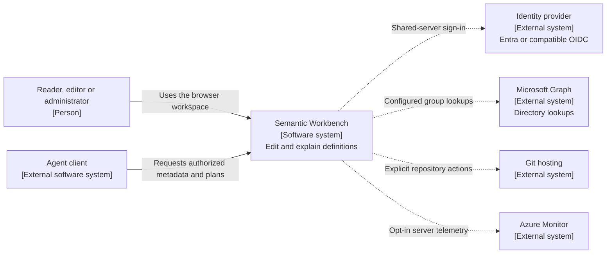
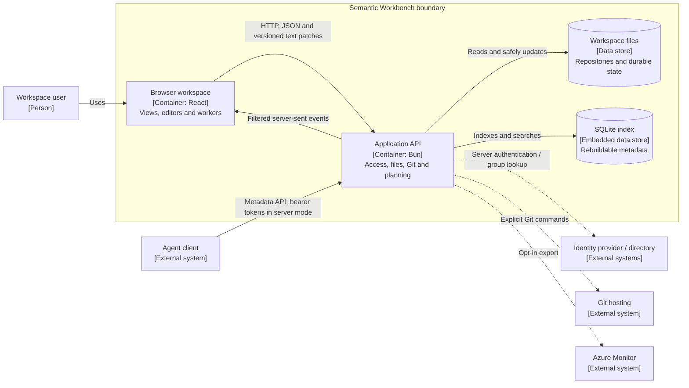

# Semantic Workbench

Explore and edit data contracts, semantic models, ontologies and governed metrics in one
workspace. Definitions stay in ordinary project files, with Git for version history. Follow a
metric from its business meaning through its formula to the columns declared in a data contract,
and review the SQL that would calculate it.

**The application never executes those SQL previews or computes live metric values.** It does not
connect to a warehouse, compute live metric values or perform OWL reasoning. It does run SHACL
shapes and their SPARQL constraints over one file of the same project, in the browser, with no
network. SQLite supports the application's internal index; it is not an analytical data source.
Separate verification scripts can execute SQL against disposable synthetic fixtures.

Semantic Workbench does not call a language model. When you connect an external agent, that agent can receive definitions you authorize and may send them to its model provider; its configuration and policies govern that onward use.

## Contents

- [Quick start](#quick-start)
- [Technology stack](#technology-stack)
- [What you can do](#what-you-can-do)
- [How the software works](#how-the-software-works)
- [Supported formats and boundaries](#supported-formats-and-boundaries)
- [Tessera: an authoring format that compiles to standard Ossie](#tessera-an-authoring-format-that-compiles-to-standard-ossie)
- [Example workspaces](#example-workspaces)
- [Local and shared-server modes](#local-and-shared-server-modes)
- [Connect an agent](#connect-an-agent)
- [Run it as a container](#run-it-as-a-container)
- [Data, recovery and Git](#data-recovery-and-git)
- [Configuration and integrations](#configuration-and-integrations)
- [Theme and white-labelling](#theme-and-white-labelling)
- [Development and verification](#development-and-verification)
- [Delivery and deployment](#delivery-and-deployment)
- [Documentation](#documentation)

## Quick start

Requirements:

- **Bun 1.4 or newer** for installation, scripts and the API.
- **Git 2.40 or newer** for local project version control. Use **Git 2.42 or newer** for shared
  servers, including personal working copies of repositories that have no commit yet.
- A current browser.

The complete quality gate also requires **Node 24.11 or newer on PATH** for isolated Vite
launches. Browser-backed tests require a separate Chromium installation. These are verification
prerequisites, not additional services needed to use the app; see [development](docs/development.md).

From the project root:

```sh
bun install --frozen-lockfile
bun run dev
```

Open **http://127.0.0.1:5173**. The API listens on **http://127.0.0.1:4310**. The development
launcher waits for API readiness before starting the frontend, and stops the two services together.
No sign-in, identity provider, cloud account or external database is needed in local mode.

Choose **Add project → Load an example** in the sidebar to load a workspace, or **Add project →
Import files** to open your definitions. A project can also start from nothing: **New file** (on an
empty project, or in a project's actions menu) creates a valid ontology, semantic model, mapping or
data contract to edit.
Configure a Git identity globally or through **Set Git identity…** in the app. The in-app action
writes repository-local settings, never your global Git configuration. Missing Git/identity does
not prevent file editing; unavailable commit operations are explained in the UI.

### Windows and a custom data folder

Keep the data root outside OneDrive and other synchronized folders. Background sync, antivirus
and indexing can hold files open during atomic replacements. The server retries transient Windows
replacement failures for up to two seconds; it cannot guarantee success under a longer lock.

PowerShell:

```powershell
$env:DATA_DIR = "C:\workbench-data"
bun run dev
```

POSIX shell:

```sh
DATA_DIR=/path/to/workbench-data bun run dev
```

For an already built local frontend served by Bun instead of Vite:

```sh
bun run build
```

Then set `SW_SERVE_STATIC=1` and run `bun src/server/index.ts`. Open the API origin on port 4310.
See [configuration](docs/configuration.md) for shell examples and binding rules.

## Technology stack

These are the primary locked versions for the current release. `package.json`, `bun.lock`,
`Dockerfile` and the pipeline setup template are authoritative; ranges in package metadata are
not necessarily the versions installed from the lockfile.

### Application and storage

| Layer | Technology | Responsibility |
| --- | --- | --- |
| Runtime/API | Bun 1.4+, TypeScript 5.9.3 | HTTP handlers, file services and scripts |
| Frontend | React / React DOM 19.3.1 | Workspace, editors, administration and views |
| Build | Vite+ 1.2.0, Rolldown | Development server and production browser bundle |
| API transport | `Bun.serve`, HTTP/JSON, SSE | Requests, live updates and reconnect replay |
| Source of truth | Filesystem and Git | Definition bytes, history and working copies |
| Rebuildable index | `bun:sqlite` | File/model caches and search metadata |
| Source editor | CodeMirror 6 / Lezer | Highlighting, lint, folding, search and diffs |
| UI icons/styles | Lucide React 0.468.0, CSS tokens | Icons, responsive layout, light/dark themes |

There is no ORM, external database server or application LLM dependency. SQLite is an internal
index, not a warehouse connected to the metric planner. Node is used by development tooling; the
application API and command scripts run with Bun.

### Graphs, definitions and query previews

| Component | Locked version | Role |
| --- | --- | --- |
| React Flow | 12.12.0, locally patched | Interactive nodes, handles and compound canvases |
| React Flow Smart Edge | 5.0.0 | Background obstacle-aware edge routing |
| Cytoscape / cytoscape-fcose | 3.34.4 / 2.2.0 | Force-directed compound layout of the Network view, in a worker |
| ELK.js | 0.12.0 | Layered layout, and spacing and packing of the areas in the Network view |
| YAML | 2.9.1 | YAML parsing and byte-preserving edits |
| Ajv / ajv-formats | 8.20.0 / 3.0.1 | JSON Schema validation and browser validators |
| N3 / rdflib | 2.13.12 / 2.4.1 | RDF parsing and graph operations |
| xmldom | 0.9.12 | XML parsing/checks for RDF/XML and brand assets |
| node-sql-parser | 5.4.0 | Supported SQL expression parsing and previews |

React Flow remains the renderer for both graph layouts. Sigma/WebGL is not an implemented mode.
Standards snapshots cover ODCS 3.1.0 and Apache Ossie 0.2.0.dev0; the latter is an unreleased
upstream draft. See [schema provenance and coverage](schemas/README.md).

The checked-in Bun patch for React Flow batches observer-driven node and pane measurements into
animation frames and cancels pending work on unmount. It does not suppress errors or replace the
global observer. Keep `patches/` with `package.json` and `bun.lock`; frozen installs and both Docker
dependency stages apply it. Behavior tests cover both ESM entrypoints and cleanup.

### Identity, policy, observability and delivery

| Component | Locked version / implementation | Role |
| --- | --- | --- |
| Entra sign-in | MSAL Node 7.1.0 | Server-side OIDC and per-session token cache |
| Other OIDC providers | openid-client 6.8.8 | Keycloak/generic sign-in compatibility |
| Token cryptography | jose 6.2.13 | Signed-token validation and key sets |
| Authorization | Cedar WASM 4.14.0 | Built-in/custom roles, scope and attribute policies |
| Telemetry | OpenTelemetry API 1.10.0, SDK 2.12.0 | Explicit traces, metrics and logs |
| Azure export | Monitor exporter 1.0.0-beta.32 | Optional server-only telemetry export |
| Tests | Bun test, Playwright 1.64.1 | Unit/API, browser, geometry and mutation checks |
| Formatting/lint | Oxfmt / Oxlint through Vite+ | Formatting, static rules and repository checks |
| Container | Digest-pinned Bun images, non-root UID 1000 | API, Git and built frontend |
| Delivery | Azure DevOps YAML, Docker/Podman, Trivy | Validation, image/SBOM and guarded delivery |

The trace and metric SDKs use OpenTelemetry 2.12.0; the log API/SDK packages use 0.200.0.
The pipeline pins its own Bun setup version. Azure is optional infrastructure, not a requirement
for running or testing the application. Local mode never exports telemetry; shared-server export
is disabled unless explicitly configured.

## What you can do

- **Define and explain metrics:** inspect formulas, dependencies, ownership, status, additivity,
  time grains, breakdowns, contract lineage and SQL previews. Create/edit governed definitions
  with a wizard; do not execute them.
- **Explore models:** full-model and neighborhood graphs, layered/network layout, area grouping,
  reversible expansion, bounded connected traversal, full screen and cross-file navigation.
- **Read data contracts:** searchable ODCS tables, properties, foreign keys, declared quality
  rules, service levels and committed property history.
- **Inspect mappings:** ontology concepts → semantic fields/metrics → physical sources, with source
  evidence, ambiguity/refusal explanations, mapping graphs and composed query previews.
- **Edit original files:** Source and item editors, YAML/JSON/RDF-aware changes, inline findings,
  stale-version conflicts, autosave, explicit multi-file saves and byte-preserving export.
- **Manage projects:** import, clone, sparse repository folders, shared-repository projects,
  Source Control, ZIP/Git-history export, trash, Undo and safe restore.
- **Collaborate securely:** shared-server sign-in, scoped grants, protected content, personal Git
  worktrees, reviewed publication, Admin changes and filtered audit/events.

Start with [the user guide](docs/user-guide.md). It explains the exact save/commit distinction,
[Git and folder workflows](docs/user-guide.md#source-control-and-git-repositories),
[graph navigation](docs/user-guide.md#model-views-and-graph-navigation),
[contract lineage](docs/user-guide.md#data-contracts-and-column-level-lineage) and
[metric authoring](docs/user-guide.md#metrics-and-governed-definitions).

## How the software works

### One workspace, two cooperating processes

The browser is a React application for exploring and editing definitions. The Bun API owns file
access, Git, durable state, access decisions and live updates. In development, Vite serves the
browser bundle separately; the built server/container serves both the API and `dist/` from one
origin. Neither arrangement needs a warehouse or a hosted AI service.

### Three views of the system

**Integrations.** What the workbench reads, what it can contact when configured, and the boundary it never crosses.


**Request and edit flow.** How a request reaches files on disk and how an edit becomes a validated, saved change.


**Identities and access.** Who can act, how they sign in, and how roles, policies and the audit record decide each request.

Network authentication lives in `src/server/auth/request-authentication.ts`. Authenticated HTTP
requests enter `operation-boundary.ts` through the thin `middleware.ts` adapter. Trusted in-process
adapters use that same boundary with minted callers and credential-free twin requests. The
[operation inventory](docs/operations.md) lists routes, effects, limits and browser-only capabilities;
this boundary does not add an MCP transport.


### C4 level 1: system context

This view shows who uses the workbench and which outside systems it can contact. Dashed links
are used only in the configured mode: server mode requires an identity provider, while directory,
remote Git and telemetry features depend on configuration. There is no warehouse or query engine.



### C4 level 2: application containers

Here, a C4 container means a running application or data store, not a Docker container. The
browser and Bun server are separate runtime units. SQLite is an embedded index, not another
network service. The built Docker image packages the Bun server, Git and static browser assets.



These are C4-style views written with standard Mermaid flowcharts so they render without a
separate diagram toolchain. [The component view](ARCHITECTURE.md#c4-level-3-backend-components)
shows the main boundaries inside the Bun container; it does not turn them into microservices.

The API uses explicit Bun HTTP handlers, not Express or an ORM-backed service. The browser does
not directly manipulate repositories. Graph layout and validation run in workers where appropriate
so metadata analysis does not monopolize the UI thread.

### From definitions to a metric explanation

The workspace connects three complementary layers:

1. **Data contracts** describe physical tables, columns, keys, quality declarations and service
   levels. They say what data is promised, not what values currently exist.
2. **Semantic models** describe datasets, fields, joins and metric expressions. Workbench
   extensions add ownership, status, additivity, time grains, breakdowns and other governed rules.
3. **Ontologies and mappings** describe business concepts and explicitly bind them to fields or
   metrics. OWL, SHACL and RDF definitions provide additional inspectable vocabulary and evidence.

For example, an `orders` contract can declare an `amount` column, a semantic field can refer to
that physical source, and `gross_revenue = SUM(orders.amount)` can be bound to a Revenue concept.
The metric page follows those declarations to show the formula, field/contract lineage, owner,
allowed breakdowns and a SQL preview. A ratio can depend on that metric and an order count; the
explanation shows the dependency tree rather than pretending a current value has been measured.

Parsing turns a file into a shared model of entities, relationships and findings. Exact names,
IRIs and explicit mapping references connect the definitions. The resolver/planner follows declared
joins and governed expressions and refuses unsupported ambiguity, incompatible grains or invalid
rollups. It does not infer that similarly named concepts are equivalent or query the source data.

### From a file edit to every open view

1. The browser loads the files the current reader may access, including their version hashes.
2. Source/item editors preserve the original serialization and validate changes. Invalid text
   stays an unsaved draft; valid Source edits autosave after the typing pause.
3. A save sends changed text/ranges and the base hash. The server authorizes all targets and, in
   server mode, applies metric/classification guards before writing.
4. A stale hash refuses the save and exposes a conflict choice. Accepted single-file writes are
   atomic; coordinated file/folder changes use a recovery journal.
5. The index is refreshed and filtered SSE events tell open views to reload readable metadata.
   Saving does not commit or push; those remain explicit Git actions.

The graph, catalog, metric explanation, mapping view and Source editor are different views of the
same definitions. They do not maintain independent copies of a metric formula.

### Graph architecture

React Flow renders interactive HTML/SVG nodes and connections. The default Network layout runs the
compound fCoSE force layout (Cytoscape) in a worker, so related entities sit close together inside
their area, and ELK then spaces the entities of each area and packs the areas without overlap. It
draws only links inside an area. The optional Layered layout uses ELK for positions and compound
routes. Smart Edge supplies worker routing at useful detail levels.

Neighborhood traversal adds nearby entities without moving existing ones and records reversible
walk/expansion history. Contract lineage and mapping graphs connect ports on rows inside cards.
Large models start with readable counted areas or bounded neighborhoods rather than drawing every
label at an unreadable size. Grouping changes the view, not the standards definitions.

Measurement caches are kept only for compatible node/port shapes. The pinned dependency patch
publishes observer-driven size changes outside the browser's resize-delivery cycle and cancels
pending work on unmount. Geometry and raw browser-error tests cover these transitions.

### Persistence and shared-server access

```text
DATA_DIR/
  projects/       published/local definition repositories
  worktrees/      server-mode personal Git working copies
  state/          registry, drafts, views, sessions, journals and audit
  admin/          versioned roles, grants, policies and settings
  trash/          deleted content and restore metadata
  backup/         legacy migration backups
  cache.sqlite    disposable index, or moved through SW_CACHE_DIR
```

In local mode, one implicit Admin edits project files directly. In server mode, OIDC establishes
identity, grants resolve scoped roles, and Cedar policies decide permitted actions/resources.
Readers see only their allowed files, including derived search, graphs, metrics, exports and agent
context. Frontend capabilities explain those decisions but cannot replace server enforcement.

An Editor's first write creates a personal worktree. Commits stay in that copy until a permitted
publisher fast-forwards the shared default branch. Publication uses version checks and is separate
from remote push. Viewer reads follow the published state. Exactly one active application writer
owns the data root; merely increasing container replicas is not safe scaling.

### Main code areas

| Area | Owns |
| --- | --- |
| `src/app/main.tsx`, `src/app/workspace/` | Browser entry and the workbench shell and its state |
| `src/app/admin/` | Browser access-administration UI and its typed API client; separate from `DATA_DIR/admin/` |
| `src/app/editor/`, `src/app/edit/` | Source/item editing and validation display |
| `src/app/metrics/`, `src/app/mappings/`, `src/app/odcs/` | Metric, mapping and contract/lineage views |
| `src/app/graph/` | Whole-model and neighborhood graphs, layout, traversal and workers |
| `src/shared/` | Code the browser and server both import: model, parsers, validation, patches, metric bindings |
| `src/shared/tessera/`, `src/server/tessera/`, `scripts/tessera.ts` | The Tessera format, its compiler, snapshot reading and bundle writing, and the command line |
| `src/app/components/`, `src/app/theme/` | Cross-feature UI and theme palettes |
| `schemas/`, `src/generated/` | Pinned schema sources and compiled browser validators |
| `src/server/routes/`, `src/server/handler.ts` | HTTP request parsing and service dispatch |
| `src/server/projects/` | Files, Git, journals, index, worktrees, trash and events |
| `src/server/auth/`, `policies/` | Identity, sessions, Cedar decisions, access review and audit |
| `src/shared/governance/` | Shared pure metric/classification protection rules |
| `src/server/agent/` | Filtered metadata, metric explanations and SQL planning |
| `src/server/usage/`, `src/app/usage/` | Opt-in, identity-free counts of requests through the workbench, and the Traffic display |
| `src/server/observability/`, `src/app/observability/` | Operational diagnostics and optional reporting |
| `public/brand/`, `src/server/brand/`, `src/shared/theme/theme.css` | Product identity and semantic theme tokens |
| `scripts/`, `tests/`, `patches/` | Tooling, isolated verification and locked dependency fixes |
| `deploy/`, pipeline YAML | Target setup, source hand-over and explicit delivery |
| `.github/` | Shared Copilot instructions and reusable agent skills |

[ARCHITECTURE.md](ARCHITECTURE.md) expands this map with concrete service owners, request flows,
authorization boundaries and invariants. It is the detailed reference for changing behavior.

## Supported formats and boundaries

| Input | Serialization | Main coverage |
| --- | --- | --- |
| ODCS | YAML, JSON | Contract/table/property forms and pinned 3.1.0 schema |
| Ossie ontology | YAML, JSON | Concepts, relationships, inheritance and IRIs |
| Ossie semantic model | YAML, JSON | Datasets, fields, joins, expressions and metrics |
| Ossie mappings | YAML, JSON | Standalone and deprecated embedded mappings |
| Tessera ontology (authoring format that compiles to standard Ossie) | YAML, JSON | An Ossie ontology with the marker `tessera: 1` and `tessera_notes`; see [Tessera](#tessera-an-authoring-format-that-compiles-to-standard-ossie) |
| RDF | Turtle, N-Triples, N3, RDF/XML | Resource inspection, safe item edits and Source |
| OWL / SHACL | Turtle or RDF/XML | Definitions and selected structural checks; SHACL shapes also run against a chosen Turtle, N-Triples or N3 data file in the project |

The input limit is **2,000,000 UTF-8 bytes per definition**. File extensions guide parser selection;
`.owl` does not identify a serialization by itself. RDF/XML is supported, not OWL/XML. JSON-LD,
TriG, N-Quads, OWL Functional Syntax and Manchester syntax are not supported inputs.

No runtime fetch of remote schemas, ontologies or `owl:imports` occurs. Schema/structure checks
are not complete semantic-conformance certification. In a SHACL shapes file, Validation details
lists the project's RDF files; pick one and the shapes (SPARQL constraints included) run against it
in the browser, with each finding naming the focus node, the shape and the rule. This is
instance validation of one file against one shapes file, with no warehouse connection and no OWL
reasoning. An Ossie file is validated against the one Ossie schema the app ships, 0.2.0.dev0. A
file that names another version, or none, still gets its syntax, structure, reference and cycle
checks, shows "Not validated" once because the schema was not applied, and has a button to validate
it as 0.2.0.dev0. The status bar reads "Not validated" in that case. Mapping files must declare
0.2.0.dev0, because the agent runtime reads only that version.

SQL highlighting and warning coverage are dialect-dependent. Non-SQL expressions such as DAX or
MDX remain plain with a not-checked note. Syntax warnings do not block autosave. The planner
refuses unsupported or ambiguous semantics rather than inventing joins, grains or aggregation.
See [validation coverage](docs/user-guide.md#validation-coverage-and-limits) and
[agent planning limits](docs/agent-runtime.md#deliberate-limits).

## Tessera: an authoring format that compiles to standard Ossie

Tessera is an authoring format that compiles to standard Ossie. A Tessera ontology is an Ossie
ontology with the top-level key `tessera: 1` (the revision of the Tessera rules) and properties
whose names start with `tessera_`. Revision 1 defines one such property, `tessera_notes`: free text
for the people who edit an ontology, on the ontology root, on a concept or on a relationship of a
concept, at most 10,000 characters. Everything else in the document is ordinary Ossie 0.2.0.dev0.

```yaml
tessera: 1
version: 0.2.0.dev0
name: Retail
ontology:
  - concept: Order
    type: EntityType
    tessera_notes: Ask finance before adding a Return concept.
```

In the workbench a Tessera ontology opens, edits, saves and appears in the graph like any other
Ossie ontology. The validation panel names the format ("Tessera 1 on Ossie 0.2.0.dev0 · 0 errors ·
0 warnings"). A document is never "Not validated": a wrong marker, an unknown or misplaced
`tessera_` property, a reserved name, a marker on a file that is not an ontology or an unsupported
Ossie `version` each give a finding with its own code (`tessera-marker`, `tessera-revision`,
`tessera-base`, `tessera-kind`, `tessera-property`, `tessera-reserved`, `tessera-location`).
Agents, the item inspector and access rules treat the file as an ordinary Ossie ontology, and notes
never reach agent context. Tests: `tests/tessera/validation.test.ts`,
`tests/tessera/workbench-documents.test.ts`, `tests/tessera/agent-and-access.test.ts`.

### The compiler and its command line

`bun run tessera compile` reads one project folder of a Git repository as it is in a commit on the
default branch (never the working tree or another branch), compiles every Tessera ontology to
standard Ossie by removing the marker and the notes, copies the other Ossie files byte for byte and
writes a bundle outside the repository and the data root’s project and working copy trees.
The output check follows symlinks and treats names like `..exports` as ordinary child folders.
The bundle contains the compiled files, `manifest.json` and
`loss-report.json`. ODCS contracts, RDF files and other files are listed in the manifest as not
included. `bun run tessera check` runs the same validation and compilation in memory, for a
committed snapshot or for a folder on disk (labelled unpublished), and writes nothing.

```sh
bun run tessera compile --repository <dir> --project-folder retail --out <dir> [--accept-loss <digest>] [--loss-policy <file>] [--json]
bun run tessera check --repository <dir> --project-folder retail
bun run tessera check --files <dir>
```

Exit statuses: 0 success (the bundle was written, or `check` found no error); 1 refused (findings, a
failed output check, an invalid source, a refused commit or output folder); 2 the compile drops
values and the loss is not accepted, so nothing was written and the report was printed; 64 misuse.

Dropped values are never silent. The loss report lists each one by document, item address, property,
JSON pointer, byte length and SHA-256, never the value, and ends with a digest. A compile with loss
is released only when you pass that exact digest (`--accept-loss`) or a loss policy file
(`{ "policy": 1, "allow": ["tessera_notes"] }`). A policy continues to allow loss when the values of allowed properties change.
An exact digest applies only to the report it identifies. A policy must be a regular file of at most
65,536 bytes, with no more allow-list entries than there are registered properties. A failure of the compile itself, such as an output
that does not pass the pinned schema, a changed meaning or two files that would write the same
path, can never be accepted. Accepting a loss report is not approval of the exported content.
Tests: `tests/tessera/compile.test.ts`, `tests/tessera/determinism.test.ts`,
`tests/tessera/loss-report.test.ts`, `tests/tessera/cli.test.ts`.

### Limits

- The compiled output is "valid against the bundled Ossie 0.2.0.dev0 draft". That Ossie version is an
  unreleased draft; the workbench pins its own copy.
- Comments and layout of a compiled YAML or JSON document may not survive. Values and key order do,
  and so does a comment above the marker.
- Notes are authoring-only: compiling drops them, and nothing recovers them. There is no
  "convert to standard" operation and no reverse compiler. Source files are never rewritten.
- The command line is an operator tool. It is not an authorization boundary: it reads Git as the
  operating-system user and applies no workbench access rules.
- The command line uses no network and needs no sign-in. Browser and HTTP export are not part of it.

## Example workspaces

Choose **Add project → Load an example** in the sidebar. Reopening an example selects its existing project rather than
importing another copy. Every metric-bearing example has simple, composed and cross-table
metrics, explicit concept bindings and ODCS inputs.

| Example | Governed metrics | Purpose |
| --- | ---: | --- |
| UBL business model | 9 | Procurement-to-payment projection of OASIS UBL 2.3 |
| Commerce workspace | 6 | Contract, semantic model, OWL, SHACL and RDF lifecycle |
| Mapped commerce | 4 | Separate ontology/model/mapping with query previews |
| Ossie Flights | 7 | Unchanged Apache examples plus labelled workbench additions |
| Subscription billing | 8 | Subscription-to-cash model and synthetic verification |
| Shopping center administration | 25 | Cross-domain retail real-estate administration |
| Commerce scale data | — | 1,000 resources / 5,000 links; navigation benchmark |

Detailed files, modeling choices and provenance:
[commerce](public/examples/commerce/README.md), [UBL](public/examples/ubl/README.md),
[Flights](public/examples/ossie/README.md), [billing](public/examples/billing/README.md) and
[shopping center](public/examples/mall/README.md).

Verification scripts may execute generated SQL on disposable synthetic SQLite fixtures. Those
checks do not add query execution to the workbench. Upstream examples remain hash-checked and
unchanged; derived schemas, analytical normalizations and extra metrics are identified as
application choices. [The example report](docs/example-verification.json) records fixture results.

## Local and shared-server modes

| | Local | Shared server |
| --- | --- | --- |
| Intended use | One person on their machine | Team workspace behind organizational sign-in |
| Binding | Loopback only | Configured host and HTTPS public origin |
| Identity | Implicit Admin, no sign-in | Entra/MSAL or compatible OIDC provider |
| Git credentials | Machine helper or SSH | Session-scoped personal remote credentials |
| Edits | Local project repositories | Personal working copy; Steward publication |
| Telemetry | Never exported | Optional, explicitly enabled Azure Monitor export |
| Agent endpoint | `POST /api/mcp` with a local capability | Not mounted |

For a shared server, install dependencies, build the frontend and supply the required settings
before `bun src/server/index.ts`. There is no application-owned password form. Roles come from
workbench grants to groups or verified addresses; provider app-role claims do not grant access.
Built-in roles are Viewer, Editor, Steward and Admin, with custom roles and Cedar conditions.

Read [server startup, grants and operations](docs/server-mode.md), then configure the target with
[the environment reference](docs/configuration.md). Real-tenant identity/consent and Azure target
acceptance are distinct from loopback mock-provider tests.

## Connect an agent

Local mode offers an endpoint, `POST /api/mcp`, for agents that speak the Model Context Protocol. A connected agent can read definitions, findings, Git history and the published mapping context, check proposed text, change files and commit exactly the files it names. It uses 21 tools, each the twin of an existing route, so access control, content guards, version checks and the audit record are the browser's own. The workbench only answers requests: it never runs a query plan, contacts a warehouse or calls a model.

Semantic Workbench does not call a language model. When you connect an external agent, that agent can receive definitions you authorize and may send them to its model provider; its configuration and policies govern that onward use.

The first start creates a secret in `data/state/mcp-capability` that only your operating-system user can read, and every request must present it. Run `bun scripts/mcp-stdio.ts` as a standard-input server in your agent client (set `DATA_DIR` and `SW_PORT` like the server), or give a client that takes a URL `http://127.0.0.1:4310/api/mcp` and the header `Authorization: Bearer <the file's contents>`. `bun run mcp:rotate` replaces the secret. The endpoint is absent in server mode, which has no agent tools yet. An agent that reads a hostile definition can be steered by it; the protocol has no way to mark text untrusted. Read [the agent endpoint guide](docs/mcp.md) for the tool list, limits, retry rules and threat model.

## Run it as a container

The image includes Bun, Git, the API, built frontend and example definitions. It runs as UID 1000
and writes only to `/data` and `/tmp` under the supported hardened profiles.

Build from the checkout:

```sh
bun run image:build
```

Or build directly:

```sh
podman build --format docker -t semantic-workbench:dev .
```

With Docker, use `docker build -t semantic-workbench:dev .`. Local-mode Compose:

```sh
mkdir -p .data
podman compose --profile local up --build
```

`docker compose --profile local up --build` is the Docker equivalent. The mounted folder must be
writable by UID 1000. Open **http://127.0.0.1:4310**.

Local mode binds loopback, so containers use host networking. On Docker Desktop 4.34+, enable
**Settings → Resources → Network → Enable host networking** and restart Docker Desktop. Linux
Docker Engine and rootless Podman do not need that Desktop setting. With Podman Machine or WSL,
verify how the VM exposes host-network loopback services to Windows; the Linux command alone is
not proof of that host integration. Native Bun is an alternative when host networking is not
available. Do not work around it by exposing unauthenticated local mode on all interfaces.

For rootless Podman, a direct invocation can map the current user:

```sh
podman run --rm --network host --userns keep-id:uid=1000,gid=1000 \
  -v "$PWD/.data:/data" semantic-workbench:dev
```

An alternative is preparing Compose ownership with `podman unshare chown -R 1000:1000 .data`.
Do not mix ownership mappings for the same folder. SELinux hosts may need the volume `:z` suffix.
Docker does not use Podman's `--userns keep-id`; prepare ownership for UID 1000 instead.

`/healthz` reports liveness, build identity and telemetry state. `/readyz` reports ownership,
recovery and scan readiness. Run one active instance per data root. A same-revision second
instance stays not ready; a different revision can report handover readiness while application
requests receive 503 until ownership transfers. Do not treat handover as serving readiness.

For production server mode, HTTPS ingress, secrets, durable storage and identity configuration,
follow [shared-server operation](docs/server-mode.md) and [the deployment guide](deploy/README.md).
The Compose Keycloak profile is a development compatibility setup, not a production template.

## Data, recovery and Git

Definitions are ordinary project files under `DATA_DIR` (`data/` by default), not rows in the
SQLite cache. The data root also contains project registration, personal copies, drafts, view
state, audit/session records, the Admin repository, trash and migration backups.

- Back up the **complete data root with the app stopped**. Project remotes alone do not include
  drafts, access settings, sessions, grouping state or trash.
- **More actions → Export** downloads the open source, including unsaved/invalid text, without saving it.
  **Export project…** archives saved working files by default, or the published snapshot when
  **Published** is selected. Both exclude drafts; neither is a draft backup. Published excludes Git history.
- The SQLite index is rebuildable. Stop the app before removing it, and expect a startup rescan.
  A cache directory on local disk is appropriate when durable files live on a network share.
- Atomic writes and journal recovery protect interrupted file/project operations. They do not
  replace backups or justify multiple independent writers on one data root.
- Git commit, publish and remote push are separate operations. Server publication advances the
  shared local default branch; it never pushes by itself.
- Local mode supports Git helpers/SSH; server mode uses HTTPS allowed hosts and personal tokens
  retained only in encrypted sessions.

- Server mode also has shared proposals: a named, reviewable line of work that several people can
  contribute to before a Steward or Admin promotes it. A repository holds at most 50 open proposals;
  names are up to 80 characters and identifiers up to 40. The guarantee is enforced by the application,
  not by the operating system, so anyone with shell access to the data root can bypass it.
- Push and Sync refuse any `work/` or `proposal/` branch in both modes. Publish the work, then use
  **Push default**.

The [user guide](docs/user-guide.md) documents autosave/conflicts, imports, project export,
trash/Undo, sparse folders and multi-project repositories. The
[server guide](docs/server-mode.md#personal-working-copies-and-publishing) explains working copies
and publication. For old local database migration, consult
[upgrade and recovery guidance](docs/configuration.md#data-layout-and-upgrades).

### Published definitions and existing Git data

A published snapshot is the immutable Git tree recorded for a repository’s default branch.
Agent catalogs, contexts, plans and programmatic metric explanations use it in both modes,
including when the author calls the agent API. Catalog, context, plan and programmatic metric responses identify their pinned commit
in `X-Workbench-Snapshot`. A readable project without Git or a published commit answers 409;
editing remains available. Browser Mappings uses the saved working copy and labels it as a preview.
HTTP and in-process operations share authorization, connection effects and audit. A person’s MCP
connection consumes published definitions independently of their browser authoring session.

Opening an existing data root records each repository's default-branch tip as its first durable
snapshot. A local commit, including an import or folder-move commit, on the default branch first
switches to `work/local`, carrying staged and unstaged changes. Commits on other branches keep their chosen branch. The commit response identifies the
authoring branch; committing does not move the published snapshot.
`POST /api/projects/:slug/git/publish` advances the default ref to the committed authoring head
after publication checks. It preserves working files and staged changes and does not push.

The default branch name is remembered from Git configuration, then the remote default,
then an existing `init.defaultBranch`, `main` or `master`, in that order.
An arbitrary feature checkout is never adopted as the default. If no default can be identified,
no snapshot is recorded and the notice asks you to choose one. Local startup preserves branch refs, commits, staged changes,
unstaged changes and untracked files; it does not repair or detach the local checkout.

| Existing workflow | After upgrade |
|---|---|
| Local default-branch commits | Adopted as the first snapshot; future default-branch commits move to `work/local`. |
| Existing local feature branch | Keeps its branch; commit and Publish when ready. |
| Server editor’s agent | Reads published definitions; Mappings still previews the editor’s own saved work. |
| Application agent | Keeps its grants and response bodies; snapshot identity is added. |
| Outside default-ref move | Remains pending until **Adopt** validates a fast-forward; divergent moves need Git repair. |
| Mapping preview URLs | Browser clients use `/api/preview/*`; reload an older open page after upgrade. |
| History source reads | Published history and the caller’s own ancestry are readable; foreign unpublished ids are missing. |
| Project ZIP | Working files remain the default; **Published** exports the committed snapshot without history. |

Local browser fetch metadata is a guardrail for ordinary clients. A program on the same machine
can forge it; local mode provides no security boundary between those programs. Shared-server
credentials and authorization provide the access boundary. See the [agent guide](docs/agent-runtime.md).

Publication checks ancestry, bounded tree readability and the existing content guards. It does
not establish the validity of a whole definition set, record cross-project dependency manifests,
create or protect release tags, or adopt non-fast-forward history. Existing tags in published
ancestry can identify historical inputs. Remote Push remains a separate action.

## Configuration and integrations

Use [docs/configuration.md](docs/configuration.md) for runtime variables and defaults.
`.env.server.example` is specifically the loopback Keycloak development profile. It is not a list
of safe production credentials and is not a production Entra template.

Server-mode configuration covers the public origin, provider/client credential, session key,
bootstrap Admins, directory access, optional agent audience and remote Git integrations. Session
lifetimes, grants, protected content and remote-host rules are administered separately in the
versioned `DATA_DIR/admin/` repository.

Operational logs are available in both modes. Telemetry export is server-only and opt-in through
`APPLICATIONINSIGHTS_CONNECTION_STRING`. Browser reports go to the workbench API; they do not
contact Azure directly or collect clicks, keystrokes or file content. Audit is a separate
hash-chained security record, not an operational telemetry feed.

Each non-HTTP operation records one audit decision, including allowed reads, with `origin`, an
inventory `tool` id and optional opaque `connection`. Protocol lifecycle records use `method`.
HTTP audit selection and existing hash chains remain unchanged. Admin and Steward audit queries
can filter by origin and tool within their existing visibility; CSV exports append these fields.
The [audit contract](specs/003-authn-authz/contracts/audit-log.md) defines the stored fields.

Usage counters are off unless an operator sets `SW_USAGE_COUNTERS=on`. They count requests through
this workbench (mapping contexts, query plans and metric explanations asked for by agent and
application clients) per published item and day, keep 30 days by default
(`SW_USAGE_RETENTION_DAYS`), and store no person, client, connection or text. They do not count queries
run in a warehouse, and browser views are excluded. They are not anonymous: in a small team a low count
may let people infer who asked. See [usage counters](docs/usage-counters.md).

[Agent clients](docs/agent-runtime.md) use Entra application tokens only on `/api/agent/*`, with
explicit project grants. The API exposes metadata, explanations and query plans, not execution.
The application does not require or call a hosted language model.

## Theme and white-labelling

The sidebar offers System, Light and Dark. Semantic color tokens live in `src/shared/theme/theme.css`, with
runtime group palettes in `src/app/theme/theme-palette.ts`. Components do not own private color literals.

A server deployment can override the product name, logo, mark, favicon and theme tokens with a
startup-loaded `SW_BRAND_DIR` bundle without rebuilding. SVG/CSS/JSON are sanitized and bounded;
invalid files fall back to defaults. Vite development serves `public/brand/` directly.

See [theme tokens and brand bundles](docs/theme.md) for exact files, limits, sanitization rules,
local/Compose setup and Azure mount examples.

## Item addresses

A `sw1` address locates a structured Ossie or ODCS item by project, document and named segments.
It supplies location, not persistent identity: a named item's address survives sibling reordering,
while renames and moves need recorded history. Unnamed items use volatile positional segments.
RDF/SHACL resources and built-ins remain unaddressed.

Mapping, lineage, selection and agent context share the grammar. Workbench renames and moves
record ordered prefix changes with their definition writes; external edits and branch switches
infer nothing. Explicit deletions stop old history at reused locators. Grouping keys and canvas
centers convert only after a verified backup, retaining unconvertible values.

History remains uncompacted, with a 50,000-record limit per project and no age-retention setting.
Caller-aware resolution checks visibility before opening definitions or history. Snapshot suffixes
remain opaque pending published-snapshot integration. See [item addresses](docs/item-addresses.md)
for the grammar, API, stability rules, storage and limits.

## Development and verification

Basic checks:

```sh
bun test
bun run check
bun run build
```

The build compiles browser-safe standalone schema validators and then the production frontend.
The check command runs TypeScript, formatting, lint, comments, theme and brand checks. Some tests
also launch Chromium; install it before running the complete test suite.

```sh
bun x playwright install chromium
bun run ci:validate
```

The complete gate requires Chromium, Node 24.11+ and Docker or Podman. It runs verify, mutation,
canonical browser suites, image build/scan/SBOM, container checks and offline pipeline validation.
Tests use disposable workspaces, local Git remotes and mock identity providers, never your real
data or a real Azure/Entra tenant. The optional Keycloak compatibility suite is separate.

When the published history has been rewritten, update an existing clone with:

```sh
git fetch --force --tags origin
git reset --keep '@{upstream}'
```

The quotes keep PowerShell from reading `@{...}` as a hash table; Bash and zsh accept them too.

`--keep` moves the current branch to its rewritten upstream and keeps uncommitted edits. It stops
without changing anything if one of those edits is in a file the rewrite also changed.

[The development guide](docs/development.md) contains the browser-suite catalog, targeted commands,
port selection, captures, mutation checks, quality limits and contributor rules. Live telemetry
and real-tenant deployment acceptance require the separate operator checklist.

For v0.5.1, the recorded full gate passed **1,893 tests**, **664 mutation targets** and all six
steps. Those are release-specific results, not promised counts for later revisions. See
[the release notes](CHANGELOG.md) and
[the validation record](specs/004-ui-polish/remaining-polish-results.json).

## Delivery and deployment

The deliverables are the source, Dockerfile/Compose setup, Azure DevOps pipeline definitions and
operator runbooks. The GitHub repository does not run workflows or automatically deploy anything.
The target imports the definitions into its Azure Repos/Azure DevOps environment.

`azure-pipelines.yml` defines Validate, Image and tag-only Deploy. The rollback pipeline is manual.
Local preview uses fake Azure clients for deployment paths; printed plans are not actual Azure
operations. Real deployment needs explicitly configured service connections, approval, target
resources and credentials. Image publishing and deployment commands are outward-facing actions,
not part of normal development startup.

**Version caveat:** Git tags such as `v0.5.1` identify source releases, but this checkout does not
declare a package version. Default image metadata is therefore `dev`; real tag deployment guards
refuse a missing/mismatching package version. Set the intended version in the target release
checkout before its approved delivery run. A Git tag alone does not satisfy that guard.

Use [the target setup and hand-over guide](deploy/README.md) and
[the acceptance/rollback runbook](deploy/trial-runbook.md). No production cloud trial is implied
by the locally recorded quality gate.

## Documentation

| Guide | Read it for |
| --- | --- |
| [Documentation index](docs/README.md) | Task-oriented map of current guides |
| [OpenWiki](docs/openwiki/README.md) | Identity architecture, MSAL/Entra wiring and production operations |
| [Observability operations](docs/openwiki/observability-operations.md) | Enable/disable logging and telemetry, profile React UI, inspect Azure data and estimate ingestion |
| [User guide](docs/user-guide.md) | Editing, metrics, graphs, imports, export and Git workflows |
| [Server guide](docs/server-mode.md) | Sign-in, grants, worktrees, governance and operations |
| [Configuration](docs/configuration.md) | Environment, data layout and startup constraints |
| [Development](docs/development.md) | Testing, browser suites, quality gate and contribution |
| [Architecture](ARCHITECTURE.md) | Module responsibilities, flows and invariants |
| [Graph design](docs/graph-design.md) | Rendering/layout engines and graph measurement rules |
| [Agent runtime](docs/agent-runtime.md) | Metadata APIs, token setup, planning and limits |
| [Usage counters](docs/usage-counters.md) | What is counted and stored, retention, the Traffic display and its limits |
| [Theme and branding](docs/theme.md) | Tokens, light/dark and white-label bundles |
| [Operation inventory](docs/operations.md) | Reviewed operations, effects, limits and browser capabilities |
| [Audit integrity](docs/audit-tamper-evidence.md) | Hash-chain checks, anchors and limitations |
| [Azure setup](deploy/README.md) | Target resources, Entra, pipelines and source hand-over |
| [Acceptance runbook](deploy/trial-runbook.md) | Real-target checks, smoke tests and rollback |
| [Schemas](schemas/README.md) | Pinned standards and application-extension provenance |
| [Changelog](CHANGELOG.md) | User-visible release changes |

Files under `specs/` retain design contracts and historical verification evidence. Current setup
and operating guidance is maintained in the guides above; historical test counts and unfinished
statements should be read in their original release context.
