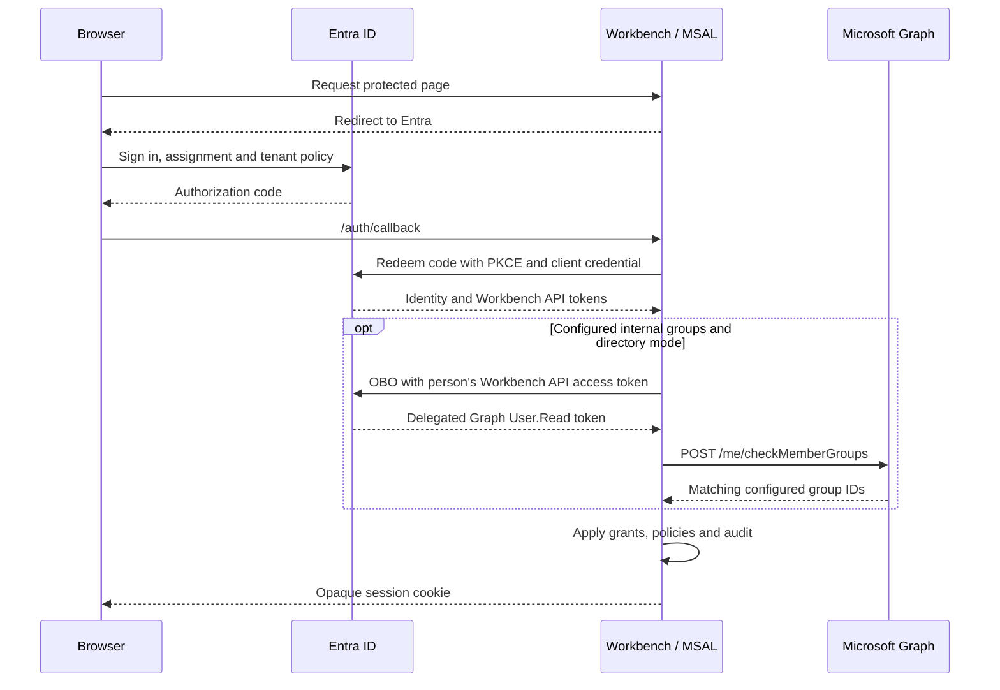

# Identity and access

[OpenWiki](README.md) | [Operations and acceptance](identity-operations.md)

## Three separate decisions

| Decision | Owner | Meaning |
| --- | --- | --- |
| Application entry | Entra Enterprise Application assignment | Who may obtain access to the application |
| Authentication | Server-side OIDC and MSAL Node | Which person signed in to the configured tenant |
| Internal authorization | Workbench grants, Cedar policies and guards | Which actions that person may perform at each scope |

To use a group for entry, set **Assignment required? = Yes** on the Enterprise Application and
assign the entry group. Remove unintended direct assignments. This is a tenant administration
step, not a setting the workbench changes.

Group assignment requires Entra ID P1/P2 and does not include nested memberships. Global
Administrators have an assignment exception, so this setting alone is not an absolute
group-members-only guarantee. Test with an ordinary user.

Internal Entra group grants remain optional alongside verified e-mail and bootstrap grants.
The entry group need not be an internal role group. Entry does not grant Viewer, Editor or
Admin; a signed-in person without a matching internal grant sees **No access**. Bootstrap
grants are an internal recovery mechanism, not a bypass of Entra's entry decision.

Accept agent token issuance/assignment separately when agents are enabled; do not assume a
change to the Enterprise Application's assignment requirement leaves every client unaffected.

## MSAL plumbing

Default login scopes are `openid profile email offline_access` plus
`api://<client-id>/access_as_user` for Entra. The App Registration exposes that API scope and
requests version 2 access tokens. The Workbench API access token, not an ID token, is the OBO
assertion. `User.Read` is delegated Graph permission, not an authentication method.

| Artifact | Use and boundary |
| --- | --- |
| ID token | Validate issuer, tenant and identity claims; it is not a Graph bearer credential |
| Workbench API access token | Assertion for downstream OBO exchanges |
| Delegated Graph token | Check the current person's membership; never use another person's token or send it to the browser |
| Serialized MSAL cache | Contains session-specific credentials, including refresh material; encrypted in the server session |
| Opaque session cookie | Identifies the server session; contains no provider token |

MSAL renews through `acquireTokenSilent` with forced refresh and the session's own cache.
Concurrent refreshes for one session are coalesced in the server process. Graph OBO results
are shared only across batches within one membership resolution, not across people.

Sessions use AES-256-GCM storage and keys derived from `SW_SESSION_KEY`. Preserve the key and
session storage across normal restarts. Rotating the key ends existing sessions. See
[session behavior](../server-mode.md#sign-in-sessions-and-sign-out) for cookies, lifetimes and logout.

## Least-privilege Graph permissions

| Operation | Required access in this model |
| --- | --- |
| Check the signed-in person's configured groups | Graph delegated `User.Read`, through `/me/checkMemberGroups` |
| Show an Entra group label in Admin | Optional local grant label; no Graph directory-name read |
| Authenticate a person | OIDC scopes and the Workbench API scope, with the configured client credential |
| Access Azure Repos on behalf of a person | Separate optional Azure DevOps delegated `user_impersonation` setup |
| Authenticate an agent client | Separate Workbench API token and explicit agent grants; no browser session |

`User.ReadBasic.All` and `GroupMember.Read.All` are not needed for this delegated self-membership
path. They belong to a different contract, such as checking other users through
`/users/{id}/checkMemberGroups`. Do not replace `/me` with that endpoint and assume the same
permissions still apply.

With assignment required, configure tenant-wide admin consent for the delegated permissions.
There is no need to have each employee separately approve `User.Read`. Consent does not itself
assign people to the application or grant internal roles.

Existing tenant-wide application grants are not automatically revoked by a code upgrade.
Review their other consumers before removing permissions that are no longer necessary.

## Internal groups and labels

In the default `SW_GROUP_OVERAGE=directory` mode, sign-in and token refresh collect only group
IDs referenced by grants and restricted paths, even when tokens have no group claims or
overage indicator. No candidates means no Graph membership request or OBO exchange for it.

Membership checks are transitive, with at most twenty IDs per request. All batches and token
acquisition share one five-second resolution budget. The client signals cancellation to pending
Graph HTTP requests and prevents late token acquisition from starting a request after cancellation.
Underlying token acquisition also has its provider transport timeout.

Malformed Entra group IDs are rejected before policy activation. A failed membership resolution
discards all results from that resolution, not just the failed batch. It supplies no group-derived
access; independent verified e-mail/bootstrap grants remain if auditing succeeds.

With `SW_GROUP_OVERAGE=off`, internal membership comes only from validated token claims;
overage fails closed without a directory lookup. Keycloak/generic provider compatibility is
separate and keeps textual group identifiers where supported.

Directory propagation and token/session lifetimes still matter. Membership is a snapshot from
sign-in or refresh, not a live check on every action. Group removal does not instantly revoke a
workbench session. Nested membership can satisfy an internal Graph check while still being
insufficient for Entra's application-assignment gate.

Hidden-membership groups have additional visibility rules. Validate actual group types and
visibility in the tenant; Graph can omit groups the caller cannot evaluate. Do not add broad
directory permissions merely to hide an unexplained membership mismatch.

Labels are cosmetic and local to each grant; access matches object IDs. An unresolved label
does not mean membership was rejected. Admin edits/listing preserve local labels, and group-name
caches are invalidated after grants, roles or rollback changes.

## Managed identities and client credentials

These are separate trusts, not interchangeable permissions:

| Identity or credential | Responsibility | Does not imply |
| --- | --- | --- |
| Workbench App Registration with a secret or certificate | Prove the confidential client's identity during sign-in, refresh and OBO | Membership of the person or internal Admin access |
| Platform managed identity used as a federated client assertion | Replace that App Registration's long-lived client credential when federation is configured | Automatic federation just by enabling managed identity |
| Workload managed identity with `AcrPull` or Key Vault permissions | Pull the container image or resolve approved secret references | Graph delegated consent, user authentication or Workbench roles |
| Pipeline federated service connections | Build, promote or deploy within approved Azure scopes | The runtime application's trust or the person's session |
| Agent application's registration or managed identity | Obtain an application token for the Workbench API | User-delegated Graph access or a browser session |

Choose exactly one server credential mechanism: a certificate pair, client secret, or
`SW_OIDC_CLIENT_ASSERTION=managed-identity`. Certificate/private-key material and secrets belong
in an approved secret store, not Git.

The managed-identity helper requests an assertion for `api://AzureADTokenExchange` through the
platform's `IDENTITY_ENDPOINT` and `IDENTITY_HEADER`. The App Registration must trust that
identity through a federated credential. The helper does not explicitly select a user-assigned
client ID; verify which identity the platform returns, especially when several are attached.

The [Container Apps target guide](../../deploy/README.md) uses `id-sw-app` for registry/Key Vault
access and optionally for client federation. That is a documented target pattern, not an
inventory of identities currently attached to a live App Service or Container App.

## Implementation map and references

| Boundary | Source |
| --- | --- |
| Discovery, MSAL, session cache, code exchange and OBO | [msal-provider.ts](../../src/server/auth/msal-provider.ts) |
| Principal resolution, refresh ordering and pending audit | [authentication.ts](../../src/server/auth/authentication.ts) |
| Candidate IDs, validation, batching, deadline and name cache | [directory.ts](../../src/server/auth/directory.ts) |
| Encrypted persistence and revocation-safe updates | [sessions.ts](../../src/server/auth/sessions.ts) |
| Claims and group normalization | [principal.ts](../../src/server/auth/principal.ts) |
| Platform assertion acquisition | [managed-identity.ts](../../src/server/auth/managed-identity.ts) |
| Administration and cache invalidation | [access-admin.ts](../../src/server/auth/access-admin.ts) |

Microsoft references:
[application assignment](https://learn.microsoft.com/en-us/entra/identity-platform/howto-restrict-your-app-to-a-set-of-users),
[group assignment](https://learn.microsoft.com/en-us/entra/identity/enterprise-apps/assign-user-or-group-access-portal),
[checkMemberGroups permissions and visibility](https://learn.microsoft.com/en-us/graph/api/directoryobject-checkmembergroups?view=graph-rest-1.0),
[on-behalf-of flow](https://learn.microsoft.com/en-us/entra/identity-platform/v2-oauth2-on-behalf-of-flow).
