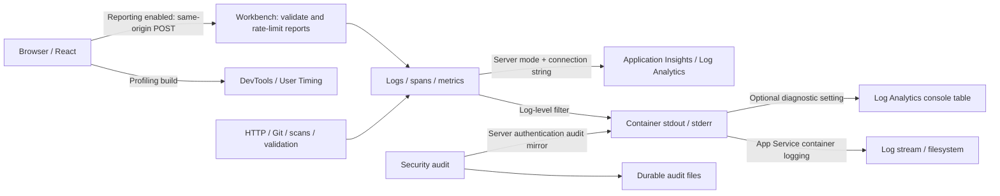

# Logging, telemetry and UI profiling

[OpenWiki](README.md) | [Configuration](../configuration.md#logging-and-telemetry) |
[Development](../development.md#profiling-the-react-ui)

## What is connected to what

Operational logs, exported telemetry, browser measurements and security audit are separate
paths. Enabling one does not automatically enable the others.



| Signal | Switch | Where to inspect |
| --- | --- | --- |
| Operational log lines, including completed-request durations | `SW_LOG_LEVEL`; default `info` | Container stdout; App Service Log stream when collection is enabled |
| Exported operational logs, backend spans and metrics | `SW_MODE=server` and a valid `APPLICATIONINSIGHTS_CONNECTION_STRING` | Application Insights and its Log Analytics workspace |
| Detailed React render measurements and Event Timing | Profiling-enabled browser build | Browser DevTools, even with telemetry export off |
| Sampled React reports, browser errors and selected operation timings | Telemetry export enabled; React reports also need the profiling build | Workbench report endpoint, then operational logs and Azure telemetry |
| Security audit | The server's authentication/access audit path, independently of telemetry | Durable audit files and server stdout mirror; see [audit integrity](../audit-tamper-evidence.md) |
| Platform CPU, memory, requests and HTTP response time | Azure platform metrics | App Service Metrics; plan-level metrics require access to the plan |

The backend already measures HTTP, Git, scans, validation, access reload and authentication.
This is not a Bun CPU/heap profiler. The React feature does not add backend event-loop lag,
queue-wait measurements or a complete request-phase breakdown.

## Two independent switches

| Browser build | Telemetry export | Result |
| --- | --- | --- |
| Normal | Off | Operational stdout only; no React measurements or browser-report sending |
| Normal | On | Backend telemetry and existing browser reports; no React Profiler measurements |
| Profiling | Off | Operational stdout plus local UI measurements; no browser-report sending |
| Profiling | On | Backend telemetry, local UI measurements and bounded browser-report export |

Telemetry never exports in local mode, even when a connection string is present.
`SW_PROFILE_UI` is a Docker **build argument**, not an application runtime setting.
`SW_TRACE_SAMPLE_RATIO` samples backend traces, not logs, metrics or React reports.

## Ownership and prerequisites

| Owner | Required preparation |
| --- | --- |
| Azure subscription owner | Active subscription and permission to build, deploy and configure monitoring |
| Platform/SRE | Working server-mode deployment, HTTPS, persistent data and session-key storage, registry access and rollback image |
| Monitoring owner | Workspace-based Application Insights, approved Log Analytics workspace, retention, access controls and cost alerts |
| Key Vault owner | Connection-string secret and permission for the App Service reference identity to resolve it |
| Application owner | Diagnostic build/version, a repeatable slow action and a time window for profiling |

This page uses App Service commands. The shipped deployment scripts target Container Apps:
their deployment/rollback adapter must not be used as if it were an App Service adapter.
The [target guide](../../deploy/README.md) and [operator runbook](../../deploy/trial-runbook.md)
own the broader delivery and storage requirements.

Do not change Entra permissions, session keys or data mounts merely to turn on observability.
If the subscription is disabled, the app is stopped or startup is failing, restore availability
first; no telemetry setting bypasses those conditions.

## Enable backend telemetry

1. In Azure, create or select a **workspace-based Application Insights** resource linked to
   the approved Log Analytics workspace. Prefer the approved application region.
2. Store its **connection string** in Key Vault. Do not copy it into Git, wiki pages or tickets.
3. Ensure the identity used by App Service Key Vault references can resolve that secret.
4. Configure the application settings below. Keep the existing server-mode authentication,
   public URL, storage and listener settings unchanged.

| Setting | Initial value |
| --- | --- |
| `APPLICATIONINSIGHTS_CONNECTION_STRING` | App Service Key Vault reference to the connection-string secret |
| `SW_LOG_LEVEL` | `info` |
| `SW_TRACE_SAMPLE_RATIO` | `0.1` for routine operation; temporarily `1` for a controlled trace capture |
| `SW_TELEMETRY_ACTOR_SALT` | Optional Key Vault reference to a stable, secret pseudonym salt |

The complete variable contract is in [configuration](../configuration.md#logging-and-telemetry).
A stable actor salt allows pseudonym correlation across restarts; it does not contain a person's
identity. Without it, actor pseudonyms change at startup.

PowerShell example, using a secret **URI**, never its value:

```powershell
$resourceGroup = "<resource-group>"
$app = "<app-service-name>"
$publicUrl = "https://<app-host>"
$insightsSecretUri = "https://<vault>.vault.azure.net/secrets/<secret-name>/"

az webapp config appsettings set `
    --resource-group $resourceGroup --name $app `
    --settings `
        "APPLICATIONINSIGHTS_CONNECTION_STRING=@Microsoft.KeyVault(SecretUri=$insightsSecretUri)" `
        "SW_LOG_LEVEL=info" `
        "SW_TRACE_SAMPLE_RATIO=0.1" `
    --output none

if ($LASTEXITCODE -ne 0) { throw "Telemetry configuration failed." }

az webapp restart --resource-group $resourceGroup --name $app
if ($LASTEXITCODE -ne 0) { throw "Application restart failed." }
```

Use the optional actor-salt reference through the same approved secret-reference mechanism.
Keep Azure CLI resource selection explicit if several subscriptions are available.

An unresolved Key Vault reference is not a usable connection string. Check reference resolution
in App Service before investigating exporter networking.

## Enable container logs

HTTP access logging alone does not establish that container stdout/stderr is being collected.
For App Service:

```powershell
az webapp log config --resource-group $resourceGroup --name $app `
    --docker-container-logging filesystem
if ($LASTEXITCODE -ne 0) { throw "Container log configuration failed." }

az webapp log tail --resource-group $resourceGroup --name $app
```

The portal equivalent is **App Service > Log stream**, after enabling container logging.
Filesystem logs are bounded operational storage, not a durable monitoring archive.

For retained console history, configure an App Service **Diagnostic setting** that sends
`AppServiceConsoleLogs` to the approved Log Analytics workspace. Add `AppServiceHTTPLogs` only
when access-log history is needed. This is separate from the application's OpenTelemetry export.

Console collection includes the audit mirror and potentially more detail than the strict
Application Insights export allow-list. Apply appropriate access and retention controls.
Collecting both console operational lines and their Application Insights equivalents duplicates
some events and increases ingestion.

## Enable the React profiling build

For a browser build:

```powershell
bun run build --mode profile
```

For a container image, pass `--build-arg SW_PROFILE_UI=1` to the approved builder.
The normal image-build helper and pipeline do not currently forward this opt-in argument.
Setting an App Service variable named `SW_PROFILE_UI` does not replace the required rebuild.

Example with Podman, from a clean, committed checkout:

```powershell
$commit = git rev-parse HEAD
if ($LASTEXITCODE -ne 0) { throw "Cannot identify the source commit." }
if (git status --porcelain) { throw "Commit reviewed changes before building." }
$version = "profile-$($commit.Substring(0, 12))"
$image = "<registry-host>/semantic-workbench:$version"

podman build --format docker `
    --build-arg SW_PROFILE_UI=1 `
    --build-arg "SW_COMMIT=$commit" `
    --build-arg "SW_VERSION=$version" `
    --tag $image .
if ($LASTEXITCODE -ne 0) { throw "Profiling image build failed." }
```

Complete the approved scan and registry-push steps before deployment. Use a distinct profiling
tag/digest rather than replacing the normal image for the same source commit. Record the
previous image reference for rollback.

For an App Service using **site containers**, update its existing main container:

```powershell
az webapp sitecontainers update `
    --resource-group $resourceGroup --name $app `
    --container-name "<existing-main-container-name>" `
    --image $image --target-port 4310
if ($LASTEXITCODE -ne 0) { throw "Container image update failed." }
```

Use the actual configured application port if it differs from 4310. Preserve the existing
main-container identity, registry authentication, startup configuration and persistent mounts.
Do not add a sidecar or use legacy single-container instructions for a site-container deployment.

Profiling adds overhead. Use a controlled window and compare with the normal build; do not
interpret a profiling build as a zero-overhead production baseline.

## Verify that each path is working

### Health and build identity

```powershell
$health = Invoke-RestMethod "$publicUrl/healthz"
$health | Select-Object ok, version, commit, telemetry
if (-not $health.telemetry.enabled) { throw "Telemetry export is not enabled." }

Invoke-RestMethod "$publicUrl/readyz"
```

Require the expected version/commit, enabled telemetry and a ready response. Health confirms
the configured telemetry state, **not successful delivery** to Azure. Confirm delivery separately.
Watch stdout for `telemetry.export-problem`; these diagnostics are deliberately not exported
through the same telemetry pipeline that is failing.

### Browser reports

Sign in and inspect the `/api/me` response: `telemetry.browserReports` must be `true`.
Reproduce the slow action and check the browser Network panel for same-origin
`POST /api/telemetry/browser` responses with status **204**. Reports are batched, so they are not
sent after every commit. An empty queue does not produce a request.

The browser sends no direct request to an Application Insights browser collector. The server
validates reports before logging/exporting them. A 204 acknowledges acceptance, not Azure delivery.

### Workspace logs and backend traces

Run this in the linked **Log Analytics workspace > Logs**, allowing for ingestion delay:

```kusto
AppTraces
| where TimeGenerated > ago(1h)
| where AppRoleName == "semantic-workbench"
| where Message in ("http.request", "browser.react-render", "browser.slow-operation")
| project TimeGenerated, Message,
    RequestId = tostring(Properties.requestId),
    Area = tostring(Properties.area),
    Phase = tostring(Properties.phase),
    DurationMs = todouble(Properties.durationMs),
    ActualRenderMs = todouble(Properties.actualDurationMs),
    BaseRenderMs = todouble(Properties.baseDurationMs),
    OperationId
| order by TimeGenerated desc
```

On a shared workspace, also filter by the Application Insights resource ID. These are workspace
table/column names; the Application Insights resource-scoped Logs experience can expose aliases.

Use a browser API response's `X-Request-Id` to find its `http.request` event. Sampled backend
requests and child operations appear in `AppRequests` and `AppDependencies`, and share their
trace's `OperationId`. The React report's request ID belongs to its reporting POST, not
automatically to the original API request that triggered the UI update.

React durations are also exported as `sw.browser.react.render.duration` and
`sw.browser.react.base.duration`; existing operation durations use
`sw.browser.operation.duration`. Workspace metric records appear in `AppMetrics`.
Platform CPU/memory views are separate and do not become a full backend CPU profile.

### Detailed React and interaction timeline

Open browser **DevTools > Performance**, start a recording, reproduce the slow action and stop.
Inspect the User Timing track:

| Measurement | Meaning |
| --- | --- |
| `sw.react.<area>.<phase>` | Elapsed time from React's render start to commit timestamp, including scheduling delays |
| `actualDurationMs` in the React measure's detail | Time spent rendering that subtree for the update |
| `baseDurationMs` in the detail | React's estimate of rendering the whole subtree without memoization |
| `sw.ui.interaction` | Event Timing duration through the next paint, including input delay, handling and presentation delay |

Areas are fixed: `app`, `sidebar`, `canvas`, `details`, `dialogs`. Phases are `mount`, `update`
and `nested-update`. Nested areas overlap; do not add them to the app total. These are not DOM
commit-duration measurements, and the interaction samples are not a page-level INP calculation.
Interaction measurements require browser Event Timing support; events shorter than 16 ms are
not observed. No DOM target, input value, document name or component props are captured.

The latest measurement per area/phase and the latest interaction can be inspected with
`performance.getEntriesByType('measure')`. The active DevTools recording captures the detailed
timeline. Local measurements remain available when server telemetry is off.

Exported browser data is intentionally incomplete:

- React reports are throttled to at most one per second per area/phase.
- The queue holds at most 50 reports; batches hold at most 20.
- A page session sends at most 100 reports, shared by timings and errors.
- Slow operation reports are throttled per operation; interaction reports require more than 200 ms.
- Failed sends are dropped, not retried. Authentication/refusal responses can stop sending.

Use a fresh page session for a new exported capture if its limit has been reached. Use DevTools
for every-commit detail; Azure samples are not an exhaustive interaction or render history.

## Costs and routine defaults

Start with `SW_LOG_LEVEL=info`, 10% backend trace sampling and profiling enabled only while
investigating. Setting trace sampling to zero does not disable log or metric export. Increasing
trace sampling to one does not remove browser-report limits.

Do not assume the size of stdout files equals Azure billable ingestion. Measure `_BilledSize`
in the workspace. After a representative 24 hours, substitute the actual resource IDs:

```kusto
let resources = dynamic([
    "<Application Insights resource ID>",
    "<App Service resource ID>"
]);
union isfuzzy=true withsource=Table
    AppTraces, AppRequests, AppDependencies, AppMetrics,
    AppExceptions, AppServiceConsoleLogs, AppServiceHTTPLogs
| where TimeGenerated > ago(24h)
| where _ResourceId in~ (resources)
| where _IsBillable =~ "true"
| summarize DailyGB = sum(_BilledSize) / 1e9 by Table
| extend ProjectedMonthlyGB = DailyGB * 30
| order by DailyGB desc
```

For a small, eight-active-user workload, **50-100 MB/day** is a provisional planning allowance,
not measured production usage or a guaranteed ceiling. It assumes roughly 500 API requests and
two page sessions per user per day, 10% trace sampling and bounded browser reporting. Metrics,
background work and duplicate console collection prevent simple linear scaling by user count.

Public Brazil South Analytics ingestion rates checked on **2026-11-03** were **USD 4.60/GB**
and **BRL 24.7289/GB**. At 30 days, before free allowances:

| Daily ingestion | Monthly volume | USD/month | BRL/month |
| --- | --- | --- | --- |
| 50 MB | 1.5 GB | 6.90 | 37.09 |
| 100 MB | 3 GB | 13.80 | 74.19 |

The first 5 GB/month is shared per billing account, not per application. If that whole allowance
remains available, these ingestion examples are covered. Prices and eligibility can change;
check the actual agreement and workspace region. Taxes, currency adjustments, extra retention,
exports, alerts and other services are outside this ingestion-only estimate. Keep retention within
the included period for each table unless longer retention is required.

Set budget/usage alerts. An ingestion cap can create monitoring gaps and is not a guaranteed
hard spending limit. It does not stop local audit files or every other Azure charge.

## Turn it off or roll back

| Objective | Action | What remains |
| --- | --- | --- |
| Remove React profiling overhead | Build/deploy a normal image with `SW_PROFILE_UI=0`, or run `bun run build` without profile mode | Backend logging/export and normal browser reporting remain configured |
| Stop exported telemetry, including browser reports | Remove `APPLICATIONINSIGHTS_CONNECTION_STRING` and restart | Operational stdout, security audit and local UI measurements in an existing profiling build |
| Reduce routine operational log volume | Set `SW_LOG_LEVEL=warn` and restart | Warnings/errors and configured metrics/traces; routine request/React info logs are filtered |
| Restore a failed deployment | Redeploy the recorded previous image using the target's approved rollback procedure | Existing data/session storage and secrets must be preserved |

For example, to disable export without printing the secret:

```powershell
az webapp config appsettings delete `
    --resource-group $resourceGroup --name $app `
    --setting-names APPLICATIONINSIGHTS_CONNECTION_STRING --output none
if ($LASTEXITCODE -ne 0) { throw "Telemetry removal failed." }

az webapp restart --resource-group $resourceGroup --name $app
if ($LASTEXITCODE -ne 0) { throw "Application restart failed." }
```

Verify `/healthz` reports telemetry off and a fresh page's `/api/me` disables browser reporting.
Turning off export does not delete already-ingested records. Changing the runtime
`SW_PROFILE_UI` variable or merely lowering the trace sample ratio is not a substitute for
deploying the normal browser build.

## Failure and acceptance checks

| Symptom | Check |
| --- | --- |
| Health is available but telemetry is off | Server mode, resolved connection string and restart |
| No stdout in Log stream | Container logging, selected app/slot and container health; HTTP access logging is separate |
| Telemetry is enabled but Azure tables stay empty | Ingestion delay, correct workspace/resource/time range, ingestion reachability and stdout exporter warnings |
| No React measures in DevTools | Actual deployed profiling build, expected build identity and a new page load |
| UI measures exist locally but no reports are sent | `/api/me` switch, sign-in, report limits and endpoint status |
| Report endpoint returns 400/401/403/404/429 | Schema, session, permissions, reporting switch or rate limit; do not bypass the access boundary |
| Logs exist but some backend traces are absent | Trace sampling; use a short 100% trace capture if approved |
| Build identity is `dev` / `unknown` | Supply image version/commit metadata; do not attribute an incident to an unverified revision |
| Subscription disabled, app stopped or startup fails | Restore platform access/availability before testing export |

Accept production collection only after seeing the expected build, ready/health responses, a real
request log, a sampled backend trace, a React timing and an accepted browser report. Verify the
normal build and telemetry-off behavior separately. Local tests are not proof of Azure delivery.

Never attach raw tokens, cookies, connection strings, complete network archives or personal audit
records to the wiki or incident tickets. Keep sanitized timestamps, request/trace IDs and the
minimal reproduction instead.

## Implementation and references

| Boundary | Source |
| --- | --- |
| Runtime logging/export settings | [settings.ts](../../src/server/observability/settings.ts) |
| Request duration and correlation | [http-request.ts](../../src/server/observability/http-request.ts) |
| Telemetry startup and exported-field allow-list | [telemetry.ts](../../src/server/observability/telemetry.ts) |
| Metrics and browser report recording | [metrics.ts](../../src/server/observability/metrics.ts), [browser-report-recorder.ts](../../src/server/observability/browser-report-recorder.ts) |
| React callbacks and Event Timing | [ui-profiling.tsx](../../src/app/observability/ui-profiling.tsx) |
| Browser batching and limits | [reporter.ts](../../src/app/observability/reporter.ts) |
| Report schema and budgets | [browser-report.ts](../../src/shared/observability/browser-report.ts) |
| Profiling build selection | [vite.config.ts](../../vite.config.ts), [Dockerfile](../../Dockerfile) |

Microsoft references:
[App Service logs](https://learn.microsoft.com/en-us/azure/app-service/troubleshoot-diagnostic-logs),
[App Service Key Vault references](https://learn.microsoft.com/en-us/azure/app-service/app-service-key-vault-references),
[workspace-based Application Insights](https://learn.microsoft.com/en-us/azure/azure-monitor/app/create-workspace-resource),
[Azure Monitor pricing](https://azure.microsoft.com/en-us/pricing/details/monitor/),
[billing calculations](https://learn.microsoft.com/en-us/azure/azure-monitor/logs/cost-logs),
[retention](https://learn.microsoft.com/en-us/azure/azure-monitor/logs/data-retention-configure),
[Retail Prices API](https://learn.microsoft.com/en-us/rest/api/cost-management/retail-prices/azure-retail-prices).
